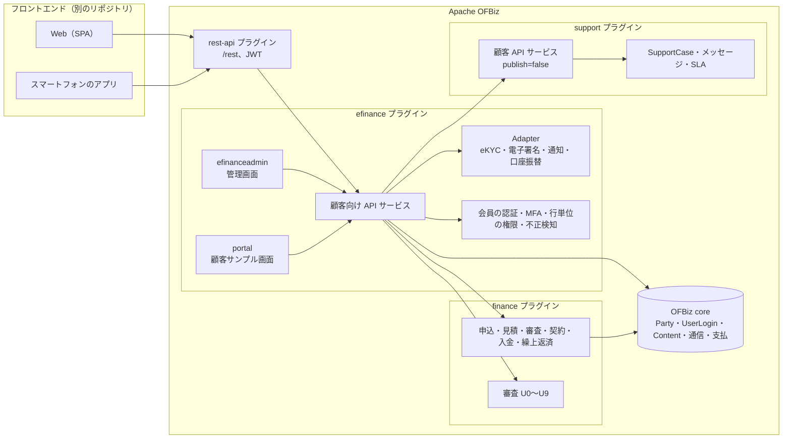
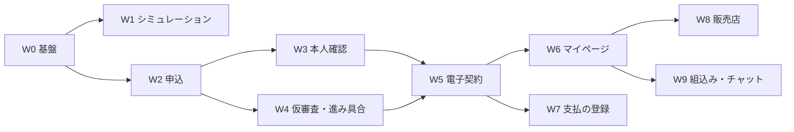

# Apache OFBiz eFinance（Web 申込・顧客ポータル）

ローン・リースを **Web で申込から契約・契約後の手続きまで完結** できるようにする、顧客向けのプラグイン `efinance` の要件定義。OFBiz の ecommerce（order・product の上に乗る顧客向けの店舗）と同じ考え方で、finance の上に乗る顧客向けの仕組みとする。詳細な設計は `SPEC_EFINANCE.md` を正とする。

> **状態：W0〜W6 の API・DB は実装済み（2026-10-22 更新）**。サービス権限、JWT の `jti` 対応、OTP 非公開、同意文書 seed、KYC・同意ゲート、support 顧客 API ブリッジを追加した。残る主な未実装は、リクエスト単位の認証フィルタ、法人アカウント、管理画面、顧客サンプル画面、PDF 生成、通知・段階イベントである。2026-10-17 に方針を決定し、2026-10-21 に W0〜W6 を実装、2026-10-22 にセキュリティと support 連携を追加した。

---

## 1. 全体方針

### 1.1 背景と目的

| 目的 | 内容 |
|------|------|
| 申込の完結 | 商品を調べてから、申込・本人確認・審査・契約・初回の支払の登録までを、来店・郵送なしで行える |
| 契約後の利便 | 契約・返済・入金の照会、繰上返済・条件変更・満了時の選択・住所の変更などを、顧客自身が行える |
| 業務の効率 | 入力・書類の確認・郵送の手間を減らし、finance の審査（`REQUIREMENTS_UNDERWRITING.md`）と担当者の作業に、整った情報をつなぐ |
| 広く使われる | スマートフォンで使いやすく、費用が分かりやすく、安心できるサービスにする |

### 1.2 確定事項

| 項目 | 決定 |
|------|------|
| 主な利用者 | **個人の直接の申込**と**法人の直接の申込**を最初の重点とする。販売店のポータル（W8）・提携先への組込み（W9）は後の STEP |
| 画面の作り方 | **rest-api の API と、別のフロントエンド（SPA・スマートフォンのアプリ）に分ける**。efinance は API・サービス・設定・データを持ち、顧客向けの本番画面は持たない。担当者向けの管理画面は efinance 内の小さな Web アプリ、顧客向けのサンプル画面は `/portal` に置く |
| 外部のサービス | **eKYC・電子契約・SMS・口座振替は、差し替えられる Adapter と簡単な実装（手動・テスト用）を先に作り、製品別の実装は将来**（審査の `CreditInfoAdapter` と同じ考え方） |
| 依存 | **efinance → finance**（finance の共通層・ローン層・リース層の公開サービスを呼ぶ）、**efinance → support**（support の顧客 API を内部から呼ぶ）、OFBiz core、rest-api。**ecommerce には依存しない**。finance は efinance を参照しない。support は efinance を参照しない |
| 業務の規則 | efinance はローン・リースの業務を自分では持たない。申込・見積・審査・契約・入金・繰上返済などは **finance の既存のサービス** を呼んで行い、業務の状態は finance の状態遷移サービスだけが変える（AGENTS.md の規則） |
| 権限 | 顧客は **自分の申込・契約だけ** を見て操作できる（行単位の権限）。担当者の操作は finance・support の権限のまま |
| JWT 実装 | 独自 `EfToken`（アクセストークン）+ `EfRefreshToken`（更新トークン）で管理し、OFBiz の `JWTManager` で標準 JWT を発行する。将来の外部 IdP 連携に備えた設計とする |
| REST 公開 | efinance が `/rest` の統合エンドポイントを持つ（案 A）。support の `publish="false"` は維持。efinance が support の顧客 API を内部から呼ぶ |
| スタッフ画面 | efinance 内の `/efinanceadmin` に集約。ケース管理は support のまま |
| 顧客サンプル画面 | efinance 内の `/portal` にサンプル実装を置く（フロントエンドは別リポジトリで置き換え可） |
| 監査ログ | 各プラグイン独立（`EfAuditLog` / `SupportAuditLog`）。監査ログの統合は行わない |

### 1.3 対象外

- フロントエンド（SPA・スマートフォンのアプリ）そのもの。API 仕様のみ efinance が持つ。
- 製品別の外部サービス実装（eKYC・電子署名・SMS・口座振替・郵便番号・法人番号）。
- カード決済代行、オンライン即時入金。
- 顧客行動分析・マーケティング自動化。
- support のケース管理画面・SLA 管理（support プラグインの責務）。
- finance の審査（U0〜U9）の判定ロジックそのもの（finance の責務）。

### 1.4 用語

| 用語 | 意味 |
|------|------|
| **会員** | efinance に登録した顧客（個人、または法人の担当者）。OFBiz の `Party`・`UserLogin` |
| **法人アカウント** | 法人（`Party`、PARTY_GROUP）と、その担当者（会員）の組。担当者ごとに権限（申込・照会・支払の手続き）を持つ |
| **仮審査** | 申込の主要な項目から、その場で出す目安の結果。本審査の結果を約束しない |
| **本審査** | 書類・本人確認・信用情報の照会を経た finance の審査（`LoanUnderwriting`） |
| **eKYC** | オンラインの本人確認。犯罪収益移転防止法の本人確認の方法に合わせる |
| **電子交付** | 法令で交付が必要な書面を、顧客の承諾を得て電磁的な方法で交付すること |
| **申込の下書き** | 申込を送る前の、途中保存の状態 |
| **アクセストークン** | API 呼出しに使う短命の JWT。`EfToken` に発行履歴を持つ |
| **更新トークン** | アクセストークンを再発行するための長命のトークン。`EfRefreshToken` にハッシュを保存する |
| **再認証** | 契約締結・口座登録などの重要操作の直前に、MFA などで本人確認をやり直すこと |
| **行単位の権限** | 会員が自分の申込・契約だけを参照・操作できること。法人では法人の権限範囲も加わる |

### 1.5 アクターと権限

| アクター | 説明 | 主な権限 |
|----------|------|----------|
| 個人会員 | 個人の申込者・借主 | 自分の申込・契約の作成・照会・手続き・評価 |
| 法人管理者 | 法人アカウントの管理者 | 法人の担当者の招待・権限変更、法人の申込・契約の管理 |
| 法人担当者 | 法人に所属する会員 | 付与された範囲（申込・照会・支払・管理） |
| 販売店担当者（W8） | 販売店の担当者 | 顧客の代理申込・見積・検収連絡（顧客の同意が前提） |
| サポート担当者 | support のスタッフ | ケース管理・SLA・返信（support の権限） |
| efinance 管理者 | efinance の運用担当者 | 本人確認の確認、書類要請、手続き依頼、会員ロック解除 |
| システムユーザー | `efinance-system` | finance・support の内部サービス呼出し |

**権限マトリクス（抜粋）**

| 操作 | 個人会員 | 法人管理者 | 法人担当者 | efinance 管理者 | システム |
|------|:---:|:---:|:---:|:---:|:---:|
| 自分の会員情報の参照 | ○ | ○ | ○ | ○ | ○ |
| 法人の担当者の招待 | – | ○ | – | ○ | – |
| 申込の作成 | ○ | ○ | 申込権限がある場合 | – | ○ |
| 申込・契約の参照 | 自分のみ | 法人全体 | 付与範囲 | 全件 | ○ |
| 契約の締結 | ○ | 契約権限がある場合 | 契約権限がある場合 | – | ○ |
| 繰上返済の申込 | ○ | 支払権限がある場合 | 支払権限がある場合 | – | ○ |
| 本人確認の審査 | – | – | – | ○ | – |
| 書類要請・手続き依頼の処理 | – | – | – | ○ | – |
| 監査ログの閲覧 | – | – | – | ○ | ○ |

### 1.6 構成

### 1.7 開発の進め方と完了条件

- finance・support と同じく STEP ごとに「要件 → 仕様 → 実装 → 全体テスト → 仕様・記録の更新」を繰り返す。
- テストスイートは `efinancetests`。サービス単体テストに加え、REST 経由の結合テスト、finance の全体テスト（`financetests`）、support の全体テスト（`supporttests`）を回す。
- STEP の完了条件は、①サービスと API の実装、②権限・所有確認、③監査記録、④テスト、⑤仕様書への実装記録の追記、⑥既知の未実装項目の明示、とする。
- フロントエンドは OpenAPI（rest-api の `/docs`）に従って別リポジトリで作る。efinance の `/portal` は API の動作確認用サンプルとし、本番画面の置き換えを前提とする。

---

## 2. 課題と現状

### 2.1 一般的な Web ファイナンスの課題と対策

| 課題 | 対策（STEP） |
|------|-------------|
| 入力が長く、途中でやめてしまう | 何段階かに分けた入力・途中保存と再開・入力の補助（郵便番号 → 住所、法人番号 → 会社の情報）・書類の写真からの読み取り（審査 U8）（W2） |
| 結果が出るまで分からない | 仮審査の即時の回答（審査 U3・U4）、進み具合の表示と通知（W4） |
| 本人確認が面倒 | オンラインの本人確認（eKYC）、法人は代表者の確認と登記の情報（W3） |
| 紙の契約・郵送 | 電子契約、書面の電子交付（事前の承諾）、書類のダウンロード（W5） |
| 費用・条件が分かりにくい | シミュレーション（総支払額・実質年率・消費税・手数料の内訳）、比較、重要事項の分かりやすい表示（W1） |
| 契約後の手続きが不便 | マイページ（照会・各種の手続き・通知）（W6） |
| 支払の登録が面倒 | 口座振替のオンラインの登録、カード（W7） |
| なりすまし・不正 | 多要素認証、不審な操作の検知、上限の額、ロック（W0・W3・W4） |
| スマートフォンで使いにくい | API を前提に、スマートフォン優先の画面をフロントエンドで作る。アクセシビリティ（JIS X 8341-3 / WCAG 2.1 AA）を画面の要件にする |
| 問合せの窓口が分かりにくい | 案件に紐付くメッセージ、よくある質問、チャット（AI）と担当者への引継ぎ（W6・W9）。support のケースと連携する |

### 2.2 現状の実装範囲と未実装（2026-10-21）

| STEP | API・DB | 画面 | 主な未実装 |
|------|:---:|:---:|-----------|
| W0 | 実装済み | 管理画面の一部 | リクエスト単位の `EfAuthFilter`、法人アカウント、再認証、同意文書の版検証 |
| W1 | 実装済み | – | IP レート制限、公開商品の管理画面 |
| W2 | 実装済み | – | `EfFormField`、書類スキャン Adapter、住所・法人番号の照会 Adapter、重複下書きチェック、AI 読取 |
| W3 | 実装済み | KYC 一覧のみ | 申込送信時の必須同意チェック、`FinUwExternalInfo` 連携、KYC 審査画面、画像閲覧の権限制御 |
| W4 | 実装済み | – | `EfStageEvent` の作成、`NotificationAdapter`、ECA・バッチ、管理画面の書類要請 |
| W5 | 実装済み | – | PDF 生成、`ESignatureAdapter` の抽象化、再認証、L21 承認連携 |
| W6 | 実装済み | – | `FINWE_OTHER` タスク、手続き依頼の管理画面、`efSendMessage` の support ケース紐付け、契約残高の正確な照会、証明書 PDF |
| W7 | 未着手 | – | 口座振替・振込案内 |
| W8・W9 | 未着手 | – | 販売店ポータル、提携先組込み、チャット |

---

## 3. 共通要件

### 3.1 API

- 顧客向けの操作は、efinance のサービス（`export="true"`、`api/efinance.rest.xml`）として作る。
- サービスは入力を検証し、本人の申込・契約かを確かめてから、finance・support のサービスを呼ぶ。
- 顧客は finance・support のサービスを直接呼べない（`export` しない。support の REST は `publish="false"`）。
- 応答には、顧客に見せてよい項目だけを返す（内部の審査情報・スコア・担当者コメント・内部メモは返さない）。
- 多言語（日本語・英語）、多通貨（商品の通貨）に対応する。

### 3.2 認証・認可

- 会員の登録（メールアドレスの確認）、ログイン、**多要素認証**（メール・SMS のワンタイムパスワード、将来は認証アプリ・パスキー）、パスワード再設定、一定回数の失敗でロック。
- アクセストークンは短命（既定 15 分）、更新トークンは長命（既定 30 日）とし、更新時にローテーションする。
- **すべての顧客向けサービス**は `EFINANCE_CUSTOMER` 権限（または法人の権限）を検査する。`efinance-system` と管理者は例外とする。
- **行単位の権限**：会員は、自分（と自分が担当する法人）が申込者・借手・借主の申込・契約だけを扱える。`EfAccessGuard` に判定を集約する。
- 重要な操作（契約の締結、口座の登録、繰上返済の申込、住所・連絡先の変更）は、直前の**再認証**を必須にする。
- JWT の失効・会員のロック・`EfToken` の失効をリクエスト時に検証する（`EfAuthFilter` またはサービス先頭の `EfAccessGuard`）。

### 3.3 データ所有権

| データ | 所有権の判定 |
|--------|-------------|
| `EfApplicationDraft` | `memberPartyId` = ログイン会員。法人申込は `EfCorporateUser` の権限と `corporatePartyId` を確認 |
| `EfApplicationLink` | `memberPartyId` = ログイン会員、または法人の権限範囲 |
| `EfKycCheck` | `memberPartyId` = ログイン会員。法人代表者の確認は法人管理者の権限を確認 |
| `EfSigningSession` | `memberPartyId` = ログイン会員 |
| `EfServiceRequest` | `memberPartyId` = ログイン会員、または法人の権限範囲 |
| `EfDeliveredDocument` | `memberPartyId` = ログイン会員、または法人の権限範囲 |
| `EfConsent` | `partyId` = ログイン会員 |
| `EfNotificationSetting` | `memberPartyId` = ログイン会員 |

### 3.4 外部 Adapter

| 口 | 最初の実装 | 将来 |
|----|-----------|------|
| `EkycAdapter` | 画像アップロード＋担当者の目視確認（手動） | eKYC サービス API |
| `ESignatureAdapter` | クリック同意＋日時・IP・端末の記録 | 電子署名・タイムスタンプ |
| `NotificationAdapter` | メール（OFBiz の通信）、SMS はログ出力 | SMS・プッシュ通知 |
| `DirectDebitAdapter` | 口座情報の受付＋担当者による登録 | 金融機関の口座振替 API |
| `AddressLookupAdapter` / `CorporateLookupAdapter` | 郵便番号表・法人番号の手入力 | 郵便番号 API・法人番号 API |
| `FileScanAdapter` | 検査なし（テスト用） | ウイルス検査サービス |

### 3.5 法令・記録

- 犯罪収益移転防止法（本人確認の方法・記録の保存）、貸金業法・割賦販売法（広告の表示、契約前・契約時の書面と電子交付の承諾、信用情報の照会の同意）、個人情報保護法、電子署名法、電子帳簿保存法、消費者契約法、特定商取引法（該当する場合）。法務の確認を前提とする。
- 同意の記録：何に（利用規約・個人情報・信用情報照会・電子交付・電子契約）、いつ、どの版の文面に、どの端末・IP から同意したかを残す。
- 操作の記録：ログイン、申込の送信、本人確認、契約の締結、重要な変更、管理画面の操作を監査ログに残す。

### 3.6 セキュリティ

- HTTPS、CORS（フロントエンドの出所だけ）、入力検証、アップロード制限（種類・大きさ・ウイルス検査の口）、レート制限、CSRF 対策、秘密情報の非保存。
- パスワード・OTP・リセットトークン・更新トークンはハッシュで保存し、平文を API 応答・ログに出さない。**テスト用の平文返却は本番設定で無効化する**。
- 不正の検知：同一端末・IP・電話・住所・口座からの複数申込、短時間の連続申込、仮審査の繰返し、海外 IP（設定）。疑わしい申込は担当者の確認に回す。
- 監査ログにはメッセージ本文・暗証番号・口座番号を保存しない。必要ならマスクする。

### 3.7 非機能要件

| 区分 | 要件 |
|------|------|
| 性能 | 商品一覧・シミュレーションは 1 秒以内、申込保存は 2 秒以内、契約照会は 3 秒以内（p95）。 |
| 可用性 | 顧客向け API は常時稼働を目標とする。JWT はセッションに依存しない。バッチ停止時も参照・手続き受付は継続する。 |
| 同時実行 | 同じ下書き・契約への同時更新で状態の巻き戻りが起きない（楽観ロックまたは状態検証）。 |
| 冪等性 | 登録・申込送信・返信・手続き依頼は、`externalId` や一意キーで再実行しても重複しない。 |
| 国際化 | 画面・通知は日本語・英語。日付・通貨・タイムゾーンは顧客設定に従う。 |
| アクセシビリティ | サンプル画面は JIS X 8341-3 / WCAG 2.1 AA を目標とする。 |
| データ量 | 申込・契約・監査ログの増加に耐えるインデックスを持つ。書類は `Content` に置き、業務データにはリンクだけを持つ。 |
| 監査 | 誰がいつ何を閲覧・変更したかを記録する。 |
| 保存 | 本人確認・契約・監査ログの保存期間は法令・社内規程に従う。 |

### 3.8 エラーとメッセージ

- rest-api の応答形式（`statusCode`・`statusDescription`・`errorMessage`）に従う。
- 顧客向けメッセージ（多言語ラベル）と内部の `errorCode` を分ける。finance・support の内部エラー文面をそのまま返さない。
- 認証エラー（401）、権限エラー（403）、入力エラー（400）、競合（409）、見つからない（404）、サーバーエラー（500）を区別する。
- 個人情報・口座番号・OTP をエラーメッセージに含めない。

### 3.9 監査・保存

- `EfAuditLog` に、会員、操作、対象、結果、IP、端末、日時、安全な概要を記録する。
- 監査対象：登録、メール確認、ログイン成功・失敗、MFA、ログアウト、パスワード再設定、プロフィール更新、同意、トークン発行・失効、下書き作成・保存・送信・撤回、書類アップロード・削除、本人確認、仮審査、書類要請、見積受理、署名、契約、手続き依頼、メッセージ送信、管理画面の審査・ロック解除。
- 監査ログは削除せず、保存期間（既定 7 年）を設定する。個人情報はマスクする。

---

## 4. 機能要件

### 4.1 会員・認証

| ID | 要件 | 優先度 |
|----|------|--------|
| FR-AUTH-01 | 個人・法人担当者がメールアドレスとパスワードで登録できる | M |
| FR-AUTH-02 | 登録後にメール確認を経て会員を有効化する | M |
| FR-AUTH-03 | ログイン時に多要素認証を要求できる（メール・SMS） | M |
| FR-AUTH-04 | アクセストークン・更新トークンを発行し、更新時にローテーションする | M |
| FR-AUTH-05 | ログアウト・全端末ログアウトでトークンを失効する | M |
| FR-AUTH-06 | パスワード再設定をメールで行える | M |
| FR-AUTH-07 | 一定回数のログイン失敗で会員をロックし、管理者が解除できる | M |
| FR-AUTH-08 | 重要操作の直前に再認証を要求する | M |
| FR-AUTH-09 | 会員プロフィールを参照・更新できる（契約に関わる変更は手続き経由） | M |
| FR-AUTH-10 | 認証・トークン・MFA の操作を監査ログに記録する | M |
| FR-AUTH-11 | 将来の外部 IdP（OIDC）連携に備え、トークン検証を差し替え可能にする | S |

### 4.2 法人アカウント

| ID | 要件 | 優先度 |
|----|------|--------|
| FR-CORP-01 | 法人（PARTY_GROUP）と管理者会員を登録できる | M |
| FR-CORP-02 | 法人管理者が担当者を招待し、申込・照会・支払・管理の権限を付与できる | M |
| FR-CORP-03 | 法人担当者は付与された範囲の申込・契約だけを参照・操作できる | M |
| FR-CORP-04 | 法人の担当者の権限変更・無効化を監査ログに記録する | M |
| FR-CORP-05 | 法人の契約・申込を法人単位で集計できる（W8 以降） | S |

### 4.3 同意

| ID | 要件 | 優先度 |
|----|------|--------|
| FR-CONSENT-01 | 利用規約・個人情報・信用情報照会・電子交付・電子契約の同意文面を版管理する | M |
| FR-CONSENT-02 | 顧客が同意した文面の版・日時・IP・端末を記録する | M |
| FR-CONSENT-03 | 顧客が現在有効な同意文書を一覧・参照できる | M |
| FR-CONSENT-04 | 申込送信・契約締結時に必要な同意が最新版で揃っているか検証する | M |
| FR-CONSENT-05 | 同意の撤回を記録できる（法令・契約上の制約を考慮） | S |

### 4.4 商品・シミュレーション

| ID | 要件 | 優先度 |
|----|------|--------|
| FR-CAT-01 | 公開対象の金融商品を一覧・詳細表示できる（認証不要） | M |
| FR-CAT-02 | ローン返済シミュレーション（元利均等・元金均等）を提供する | M |
| FR-CAT-03 | リース料シミュレーション（ rate factor / 計算利率）を提供する | M |
| FR-CAT-04 | 総支払額・利息・消費税・手数料・実質年率を表示する | M |
| FR-CAT-05 | シミュレーション結果に「目安であり審査で変わる」旨を表示する | M |
| FR-CAT-06 | 商品公開の期間・対象・表示順を管理できる | S |
| FR-CAT-07 | 公開商品の広告表示要件（金利幅・返済例）を商品に持つ | S |

### 4.5 申込

| ID | 要件 | 優先度 |
|----|------|--------|
| FR-APP-01 | 商品・金額・期間・申込者情報を段階的に入力できる | M |
| FR-APP-02 | 下書きを途中保存し、再開できる | M |
| FR-APP-03 | リースでは希望物件を複数登録できる | M |
| FR-APP-04 | 書類をアップロードし、種類・大きさを検証する | M |
| FR-APP-05 | 申込送信時に全段階・同意・不正検知を検証する | M |
| FR-APP-06 | finance の `createLoanApplication` / `createLeaseApplication` を呼び、申込を作成する | M |
| FR-APP-07 | 送信済み申込と会員・法人のリンクを保持する | M |
| FR-APP-08 | 同じ会員・商品の重複下書きを検知する | S |
| FR-APP-09 | 郵便番号・法人番号から入力補助できる | S |
| FR-APP-10 | 書類画像から項目を AI で抽出できる（審査 U8） | C |
| FR-APP-11 | 申込送信の冪等性を保証する | M |

### 4.6 本人確認

| ID | 要件 | 優先度 |
|----|------|--------|
| FR-KYC-01 | 本人確認を開始し、方式（画像・IC チップ・郵送）を選択できる | M |
| FR-KYC-02 | 本人確認書類・容貌・IC チップの画像をアップロードできる | M |
| FR-KYC-03 | 提出後に担当者が確認し、確認済み・再提出・不可を記録できる | M |
| FR-KYC-04 | 法人は法人確認と代表者・担当者の本人確認を行う | M |
| FR-KYC-05 | 本人確認済みでない申込は契約できない（`FINUWCND_KYC`） | M |
| FR-KYC-06 | 本人確認の結果を finance の審査外部情報（`FinUwExternalInfo`、U6）に連携する | M |
| FR-KYC-07 | 本人確認画像の閲覧を権限で制限し、保存期間を設定する | M |
| FR-KYC-08 | 本人確認の操作・審査を監査ログに記録する | M |

### 4.7 仮審査・進捗

| ID | 要件 | 優先度 |
|----|------|--------|
| FR-PRE-01 | 申込内容から仮審査の目安（LIKELY / CONSULT / UNLIKELY）を返す | M |
| FR-PRE-02 | スコア・規則・内部理由を顧客に返さない | M |
| FR-PRE-03 | 仮審査の繰返し・レートを検知する | M |
| FR-PRE-04 | finance の申込・審査・見積・契約の状態を顧客向け段階に変換する | M |
| FR-PRE-05 | 段階の変化を `EfStageEvent` に記録し、通知する | M |
| FR-PRE-06 | 追加書類の要請を作成し、顧客が提出できる | M |
| FR-PRE-07 | 申込の進捗をマイページで確認できる | M |

### 4.8 電子契約・電子交付

| ID | 要件 | 優先度 |
|----|------|--------|
| FR-CTR-01 | 提示中の見積・契約条件・重要事項を参照できる | M |
| FR-CTR-02 | 見積を受理し、finance の見積状態を ACCEPTED にできる | M |
| FR-CTR-03 | 契約締結前に再認証・本人確認・同意を検証する | M |
| FR-CTR-04 | クリック同意（将来は電子署名）で契約を締結できる | M |
| FR-CTR-05 | finance の `createLoanAgreement` / `createLeaseAgreement` を呼び、契約を作成する | M |
| FR-CTR-06 | 契約書・契約前書面・重要事項を PDF で交付し、交付日時を記録する | M |
| FR-CTR-07 | 電子交付の承諾がない場合は郵送タスクを作成する | S |
| FR-CTR-08 | L21 の承認が必要な商品では承認フローを経る | S |
| FR-CTR-09 | 契約作成の失敗時は署名セッションを安易に破棄せず、担当者確認に回す | M |

### 4.9 マイページ

| ID | 要件 | 優先度 |
|----|------|--------|
| FR-MY-01 | 自分の申込・契約の一覧を参照できる | M |
| FR-MY-02 | 契約の返済予定・リース料予定・残高・支払履歴・延滞を参照できる | M |
| FR-MY-03 | 繰上返済をシミュレーションし、申込できる（ローン） | M |
| FR-MY-04 | 条件変更を申し込める | M |
| FR-MY-05 | 満了時の選択（返還・再リース・買取り）を申し込める（リース） | M |
| FR-MY-06 | 住所・連絡先・勤務先の変更を申し込める（再認証） | M |
| FR-MY-07 | 残高証明書・支払証明書を申し込める | S |
| FR-MY-08 | 申込・契約に紐付くメッセージを参照・送信できる | M |
| FR-MY-09 | 通知設定を参照・更新できる | S |
| FR-MY-10 | 手続き依頼を `EfServiceRequest` として記録し、担当者が処理できる | M |
| FR-MY-11 | 手続き依頼を finance の `FINWE_OTHER` タスクとして起票する | M |

### 4.10 支払

| ID | 要件 | 優先度 |
|----|------|--------|
| FR-PAY-01 | 口座振替の依頼を登録できる | M |
| FR-PAY-02 | 口座情報を暗号化し、表示は下 4 桁に制限する | M |
| FR-PAY-03 | 担当者が登録結果（申込中・登録済み・不備）を記録できる | M |
| FR-PAY-04 | 振込案内（振込先・契約番号・期日・金額）を表示できる | M |
| FR-PAY-05 | 入金消込は finance の入金サービスで行う | M |
| FR-PAY-06 | カード決済・口座振替結果ファイル取込は将来対応 | C |

### 4.11 管理画面

| ID | 要件 | 優先度 |
|----|------|--------|
| FR-ADMIN-01 | 会員の一覧・詳細・ロック解除ができる | M |
| FR-ADMIN-02 | 本人確認の審査（確認済み・再提出・不可）ができる | M |
| FR-ADMIN-03 | 追加書類の要請を作成できる | M |
| FR-ADMIN-04 | 手続き依頼の一覧・担当・完了・却下ができる | M |
| FR-ADMIN-05 | 申込・契約の照会と finance 画面へのリンクを提供する | M |
| FR-ADMIN-06 | 不正検知の要確認一覧を参照できる | S |
| FR-ADMIN-07 | 口座振替の登録結果を記録できる | S |
| FR-ADMIN-08 | 管理画面の操作を監査ログに記録する | M |

### 4.12 support 連携

| ID | 要件 | 優先度 |
|----|------|--------|
| FR-SUP-01 | 顧客が support のケースを作成・一覧・詳細参照できる | M |
| FR-SUP-02 | 顧客がケースに返信・クローズ・評価できる | M |
| FR-SUP-03 | 申込・契約に紐付くケースを参照できる | M |
| FR-SUP-04 | efinance のメッセージと support のケースメッセージを整合させる | M |
| FR-SUP-05 | support の `publish="false"` を維持し、efinance が統合窓口になる | M |
| FR-SUP-06 | `customerPartyId` は JWT の会員から決定し、クライアント指定を信用しない | M |
| FR-SUP-07 | support の顧客 API の所有確認と efinance の所有確認を二重に行う | M |
| FR-SUP-08 | efinance と support の監査ログをそれぞれ記録する | M |

- FR-SUP-01〜06 は `/ef/support/...` の 8 サービスとして実装済み（2026-10-22）。FR-SUP-07 は efinance の権限・所有確認と support 側の確認で実装済み。FR-SUP-08 は各プラグイン独立の監査ログで実装済み。

### 4.13 監査・保全

| ID | 要件 | 優先度 |
|----|------|--------|
| FR-AUDIT-01 | 認証・申込・KYC・契約・手続き・管理操作を監査ログに記録する | M |
| FR-AUDIT-02 | 監査ログに本文・口座番号・OTP を保存しない | M |
| FR-AUDIT-03 | 保存期間・削除・匿名化の規則を設定できる | M |
| FR-AUDIT-04 | 監査ログを管理者だけが参照できる | M |
| FR-AUDIT-05 | 書類・契約 PDF の改ざん防止（ハッシュ・版・交付記録）を行う | S |

---

## 5. 画面要件

### 5.1 担当者向け管理画面（`/efinanceadmin`）

| 画面 | 内容 | 現状 |
|------|------|------|
| 会員一覧・詳細 | 会員の検索、状態、最終ログイン、ロック解除 | 一覧・詳細あり。ロック解除なし |
| 本人確認一覧・審査 | 提出画像、審査結果、確認者、コメント | 一覧のみ。審査フォームなし |
| 書類要請 | 申込・書類種別・理由・期限・状態 | サービスあり。画面なし |
| 手続き依頼 | 繰上返済・条件変更・満了・住所変更・証明書の一覧と対応 | サービスあり。画面なし |
| 申込・契約照会 | 申込・契約の検索、finance 画面へのリンク | 未実装 |
| 不正検知 | 要確認の申込・規則・対応 | 未実装 |
| 口座振替 | 登録結果の記録 | W7 で実装 |

### 5.2 顧客サンプル画面（`/portal`）

| 画面 | 内容 | 現状 |
|------|------|------|
| ホーム | 商品紹介、ログイン、新規登録 | 仮ページのみ |
| 商品一覧・詳細 | 公開商品、シミュレーション | 未実装 |
| 申込 | 段階入力、下書き保存、書類アップロード | 未実装 |
| 本人確認 | 画像アップロード、進捗 | 未実装 |
| 見積・契約 | 見積確認、同意、署名 | 未実装 |
| マイページ | 申込・契約・返済・手続き・メッセージ | 未実装 |

- `/portal` は API の動作確認とフロントエンドの参考実装を目的とする。本番画面は別リポジトリで置き換える。
- サンプル画面も、本番 API と同じ認証・所有確認・エラー形式を使う。

---

## 6. API 要件

### 6.1 共通

- REST、JSON、UTF-8。認証は `Authorization: Bearer <JWT>`。
- リソース指向の URL（`/ef/...`）。操作は HTTP メソッドで表現する。
- 一覧はページング（`viewIndex`・`viewSize`）と並び順を提供する。
- 作成・送信系は `externalId` または一意キーで冪等にする。
- エラーは HTTP ステータス＋`errorCode`＋多言語メッセージ。
- 顧客向け API は `auth=true`、公開 API（商品・シミュレーション・登録・ログイン）は `auth=false`。

### 6.2 エンドポイント群

| 群 | 例 | 認証 | 状態 |
|----|----|:---:|------|
| 認証 | `/ef/auth/register`、`/ef/auth/login`、`/ef/auth/refresh`、`/ef/auth/logout` | 不要/要 | 実装済み |
| 同意 | `/ef/consents`、`/ef/consent-documents`（追加予定） | 要 | 一部 |
| 商品 | `/ef/products`、`/ef/simulate/loan`、`/ef/simulate/lease` | 不要 | 実装済み |
| 申込 | `/ef/applications/form`、`/ef/applications/drafts`、`/ef/applications/drafts/{id}/submit` | 不要/要 | 実装済み |
| KYC | `/ef/kyc`、`/ef/kyc/{id}/images`、`/ef/kyc/{id}/submit` | 要 | 実装済み |
| 仮審査・進捗 | `/ef/applications/drafts/{id}/prescreen`、`/status`、`/document-requests` | 要 | 実装済み |
| 契約 | `/ef/applications/drafts/{id}/offer`、`/signing`、`/documents` | 要 | 実装済み |
| マイページ | `/ef/me/applications`、`/ef/me/contracts`、`/ef/me/messages` | 要 | 実装済み |
| support（追加予定） | `/ef/support/cases`、`/ef/support/cases/{id}`、`/messages`、`/close`、`/rating` | 要 | 未実装 |
| 管理 | `/efinanceadmin/...` | 管理者 | 一部 |

### 6.3 support 連携 API（実装済み）

| efinance API | support サービス | 備考 |
|--------------|------------------|------|
| `GET /ef/support/cases` | `listSupportCasesForCustomer` | `customerPartyId` は JWT から決定 |
| `POST /ef/support/cases` | `createSupportCaseForCustomer` | `externalId` で冪等化 |
| `GET /ef/support/cases/{id}` | `getSupportCaseForCustomer` | 所有確認を二重化 |
| `POST /ef/support/cases/{id}/messages` | `replySupportCaseFromCustomer` | 内部メモは返さない |
| `POST /ef/support/cases/{id}/close` | `closeSupportCaseByCustomer` | 状態遷移は support が実施 |
| `POST /ef/support/cases/{id}/rating` | `rateSupportCase` | 解決済みのみ |
| `GET /ef/support/form-options` | `getSupportCaseFormOptions` | 契約・商品の選択肢 |
| `POST /ef/support/attachments` | `uploadSupportAttachment` | 可視メッセージのみ |

---

## 7. データ要件

### 7.1 エンティティ概要

| エンティティ | 用途 |
|--------------|------|
| `EfMember` | 会員（Party 1:1） |
| `EfCorporateAccount` / `EfCorporateUser` | 法人アカウントと担当者・権限 |
| `EfOneTimeCode` | メール確認・MFA・パスワード再設定の OTP |
| `EfToken` / `EfRefreshToken` | アクセストークン・更新トークンの発行履歴 |
| `EfConsentDocument` / `EfConsent` | 同意文面の版と同意記録 |
| `EfProductPublication` | 商品の公開設定 |
| `EfApplicationDraft` | 申込下書き |
| `EfDraftDocument` | 下書きの添付書類 |
| `EfApplicationLink` | 下書きと finance 申込のリンク |
| `EfFraudCheck` | 不正検知の結果 |
| `EfKycCheck` / `EfKycImage` | 本人確認と画像 |
| `EfPreScreenResult` | 仮審査結果（内部） |
| `EfStageEvent` | 進捗段階の変化 |
| `EfDocumentRequest` | 追加書類の要請 |
| `EfSigningSession` | 電子契約の署名セッション |
| `EfDeliveredDocument` | 交付書類 |
| `EfServiceRequest` | 契約後の手続き依頼 |
| `EfNotificationSetting` | 通知設定 |
| `EfAuditLog` | 監査ログ |

### 7.2 データの保存期間

| データ | 既定 | 備考 |
|--------|------|------|
| 本人確認（`EfKycCheck` / `EfKycImage`） | 7 年 | 法令・社内規程で確定 |
| 契約・交付書類 | 契約終了後 7 年 | 電子帳簿保存法・社内規程 |
| 監査ログ | 7 年 | 削除しない |
| 下書き（`EfApplicationDraft`） | 30 日 | 期限切れは `EFDRF_EXPIRED` |
| 申込・契約の業務データ | finance の保存期間に従う | efinance はリンクのみ保持 |

---

## 8. 統合要件

### 8.1 finance との連携

| efinance の操作 | finance のサービス | 備考 |
|------------------|----------------------|------|
| 商品・シミュレーション | `FinancialProduct` / `FinanceInterestCalculator` / `LeaseCalculator` | 参照のみ |
| 申込送信 | `createLoanApplication` / `createLeaseApplication` / `createLeaseApplicationAsset` | `efinance-system` で実行 |
| 見積受理 | `setLoanQuoteStatus` / `setLeaseQuoteStatus` | ACCEPTED |
| 契約作成 | `createLoanAgreement` / `createLeaseAgreement` | 審査・見積の前提を finance が検証 |
| 契約残高（リース） | `getLeaseAgreementBalance` | 参照 |
| 繰上返済 | `createLoanPrepayment`（担当者実行） | efinance は依頼のみ |
| 入金 | `receiveLoanPayment` / `receiveLeasePayment` | 担当者・バッチ |

- efinance は finance の業務状態を直接更新しない。状態遷移は finance のサービスだけが行う。
- finance は efinance を参照しない。

### 8.2 support との連携

- efinance は support の顧客 API サービスを内部から呼ぶ。support の REST は `publish="false"` のまま。
- `customerPartyId` は efinance の JWT から決定し、クライアントの指定を信用しない。
- efinance の所有確認と support の所有確認を二重に行う。
- support の内部メモ・担当者連絡先・SLA 内部値は顧客に返さない。
- efinance と support の監査ログは独立して記録する。
- メッセージは support の `CommunicationEvent` と `SupportCaseCommEvent` を正とし、efinance 側で二重のメッセージ基盤を作らない。

### 8.3 システムユーザー

- 内部呼出しは `efinance-system`（`SUPER` グループ）で行う。
- 顧客の `UserLogin` に finance・support の管理者権限を付けない。
- `efinance-system` の資格情報は seed に固定せず、運用時にローテーションする（将来）。

---

## 9. STEP 計画と現状

| STEP | 内容 | 状態 |
|------|------|------|
| W0 | 基盤、会員登録、ログイン、MFA、トークン、監査 | API/DB 実装済み（2026-10-22）。法人・リクエスト単位の認証フィルタは未完 |
| W1 | 商品紹介、ローン・リースシミュレーション | 実装済み（2026-10-21）。レート制限・公開管理は未完 |
| W2 | 申込下書き、書類、送信、不正検知 | 実装済み（2026-10-21）。フォーム定義・スキャン・重複防止は未完 |
| W3 | 本人確認、同意 | API 実装済み（2026-10-22）。同意文書 seed・一覧 API を追加。U6 連携・審査画面は未完 |
| W4 | 仮審査、進捗、追加書類 | API 実装済み（2026-10-21）。段階イベント・通知は未完 |
| W5 | 見積受理、署名、契約作成、交付 | API 実装済み（2026-10-22）。KYC・同意ゲートを追加。PDF・再認証は未完 |
| W6 | マイページ、手続き、メッセージ、通知設定 | API 実装済み（2026-10-22）。support ブリッジを追加。タスク・管理画面は未完 |
| W7 | 口座振替、振込案内 | 設計（未着手） |
| W8 | 販売店ポータル | 設計（未着手） |
| W9 | 提携先組込み、チャット | 設計（未着手） |

---

## 10. 受入基準

### 10.1 W0〜W6 の API 受入

1. 会員が登録し、メール確認後にログインできる。誤ったパスワードは拒否される。
2. MFA が必要な会員は、OTP 確認後にアクセストークンを得る。更新トークンで再発行できる。
3. 会員は自分の下書きを作成・保存・再開・撤回できる。他人の下書きは参照・更新できない。
4. ローン・リースの申込を送信すると、finance に `LOANAPP_RECEIVED` / `LEASEAPP_RECEIVED` の申込が作られる。
5. リース申込では希望物件が `LeaseApplicationAsset` に作られる。
6. 本人確認を開始・提出でき、担当者が確認済み・再提出・不可を記録できる。
7. 仮審査が LIKELY / CONSULT / UNLIKELY を返し、スコア・規則を返さない。
8. 申込の進捗が finance の状態に応じた顧客向け段階で表示される。
9. 提示済み見積を参照・受理し、署名セッションを作成できる。
10. 署名完了で finance の契約が作られ、交付書類の記録が作られる。
11. マイページで自分の申込・契約だけを参照できる。他人の契約は参照できない。
12. 繰上返済・条件変更・満了・住所変更・証明書の依頼が `EfServiceRequest` として記録される。
13. メッセージを送信し、自分のメッセージだけを参照できる。
14. 通知設定を参照・更新できる。

### 10.2 セキュリティ・監査の受入（未達を含む）

1. `EFINANCE_CUSTOMER` を持たない `UserLogin` は顧客向けサービスを呼べない。
2. 失効したアクセストークン・更新トークンでは API を呼べない。
3. ロックされた会員はログイン・API 呼出しできない。
4. 重要操作は再認証なしに実行できない。
5. OTP・リセットトークン・更新トークンの平文が API 応答・ログに出ない。
6. 監査ログに認証・申込・KYC・契約・手続き・管理操作が記録される。
7. 顧客 API は内部メモ・担当者連絡先・SLA 内部値を返さない。
8. 本人確認・同意が完了していない申込は契約できない。

### 10.3 support 連携の受入（API 実装済み）

1. 顧客が efinance の API から support ケースを作成・一覧・詳細参照できる。
2. 顧客がケースに返信・クローズ・評価できる。内部メモは見えない。
3. 申込・契約に紐付くケースを参照できる。
4. support の REST は `publish="false"` のままである。
5. `customerPartyId` の偽装ができない。

### 10.4 非機能・回帰

1. `efinancetests` が `errors="0"` / `failures="0"` で完了する。
2. finance の `financetests`、support の `supporttests` が完了する。
3. REST 経由の結合テスト（JWT 取得、CORS、エラー形式）が通る。
4. 既存の finance・support の画面・サービスに影響しない。

---

## 11. テスト・検証要件

| 種別 | 内容 |
|------|------|
| サービス単体 | 会員、認証、同意、商品、申込、KYC、仮審査、契約、マイページ、管理 |
| REST 結合 | JWT 取得、Authorization、CORS、エラー形式、ページング、冪等性 |
| 流れ | 個人ローン・法人リースで、登録 → 申込 → KYC → 仮審査 → 審査 → 見積 → 受理 → 署名 → 契約 → マイページ |
| 権限 | 個人・法人・管理者・システムの権限マトリクス、他人のデータ拒否 |
| セキュリティ | OTP 非公開、トークン失効、ロック、再認証、レート制限、KYC ゲート |
| Adapter | 各口の手動・テスト実装 |
| 回帰 | finance・support の全体テスト |

**現在の結果（2026-10-21）**

- `.\gradlew.bat "ofbiz --test component=efinance"`：51 テスト、`errors="0"` / `failures="0"`
- ただし REST 結合テスト、法人テスト、リクエスト単位のトークン失効テスト、再認証テストは未実装。

---

## 12. 前提・依存・リスク

| 項目 | 内容 |
|------|------|
| efinance の依存 | finance、support、OFBiz core、rest-api。ecommerce には依存しない |
| support の REST | `publish="false"` を維持。efinance が統合窓口 |
| 認証 | rest-api の JWT と efinance の `EfToken` の整合が必須 |
| finance の審査 | U0〜U9 の実装状況に依存。W4・W5 の前提 |
| 法令 | 本人確認・電子交付・広告表示・同意は法務確認が必要 |
| 個人情報 | 金融取引の機微情報。マスク・保存期間・監査が必須 |
| データ量 | 申込・契約・書類・監査ログの増加に耐える設計が必要 |
| フロントエンド | 別リポジトリ。API 仕様とサンプル画面を提供する |
| 外部 IdP | 将来の OIDC 連携に備え、トークン検証を差し替え可能にする |

---

## 13. 未決事項

| # | 事項 | 現状の決定 |
|---|------|-----------|
| 1 | 顧客 API の公開時期・経路 | efinance の `/rest` に統合。support は `publish=false` |
| 2 | JWT と `EfToken` の対応方式 | `jti` クレームを保存して失効検証する方式を推奨。現状は未対応 |
| 3 | `EfAuthFilter` の実装場所 | efinance の `/portal` は自 webapp、`/rest` は rest-api のフィルター拡張またはサービス先頭の `EfAccessGuard` で対応するか要決定 |
| 4 | 法人アカウントの実装範囲 | Entity は作成済み。サービス・画面は未着手 |
| 5 | 同意文書の版管理 | `EfConsentDocument` は作成済み。seed・一覧 API・版検証は未着手 |
| 6 | 本人確認の保存期間 | 既定 7 年。法務確認が必要 |
| 7 | 電子署名の方式 | クリック同意（電子署名法の電子署名ではない）。法務確認が必要 |
| 8 | PDF 生成 | finance の帳票／jasperreports を利用予定。未実装 |
| 9 | support 連携 | 顧客 API の 8 サービスを実装済み。`efSendMessage` のケース紐付け・管理画面は未実装 |
| 10 | 監査ログの統合 | 各プラグイン独立（決定済み） |
| 11 | 口座番号の暗号化方式 | W7 で決定（`EntityCrypto` 利用候補） |
| 12 | 販売店・提携先の権限 | W8・W9 で設計 |

---

## 14. 変更履歴

| 日付 | 内容 |
|------|------|
| 2026-10-17 | 初版（全体方針・STEP 計画） |
| 2026-10-21 | W0〜W6 の実装を反映。JWT・REST・スタッフ画面・顧客サンプル画面・監査ログの方針を追記。実装済み範囲と未実装範囲、FR-ID、非機能、統合、受入基準を追加 |
| 2026-10-22 | セキュリティと support 連携を反映。顧客サービスの権限チェック、JWT `jti`、OTP 非公開、同意文書 seed・一覧 API、KYC・同意ゲート、support 顧客 API ブリッジを追加。未実装範囲を更新 |
