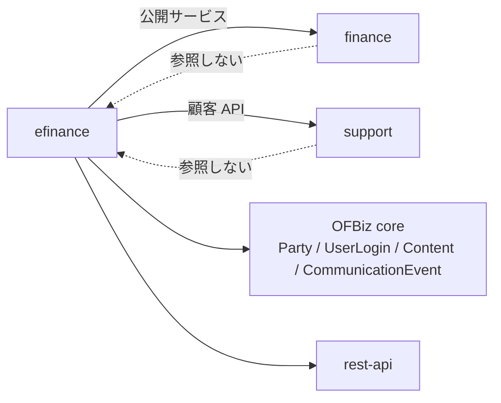
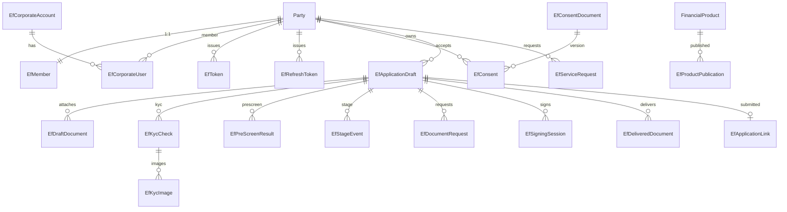
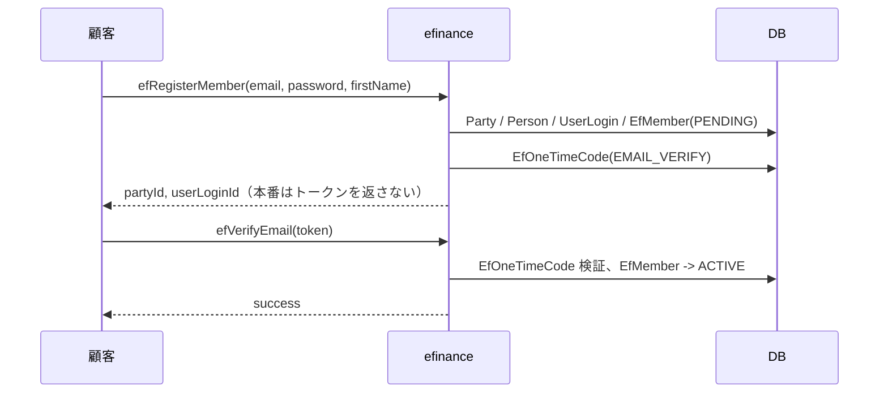
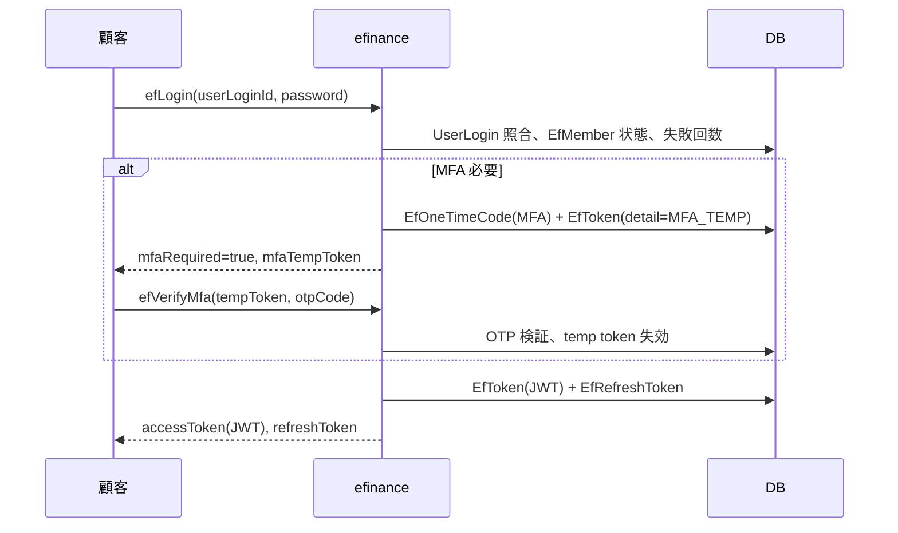
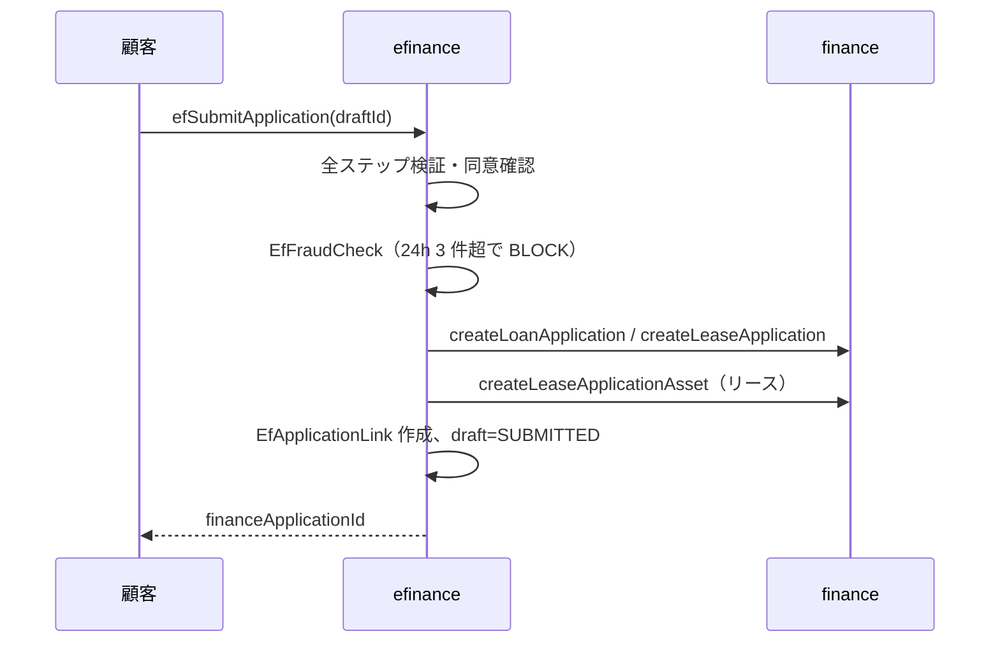
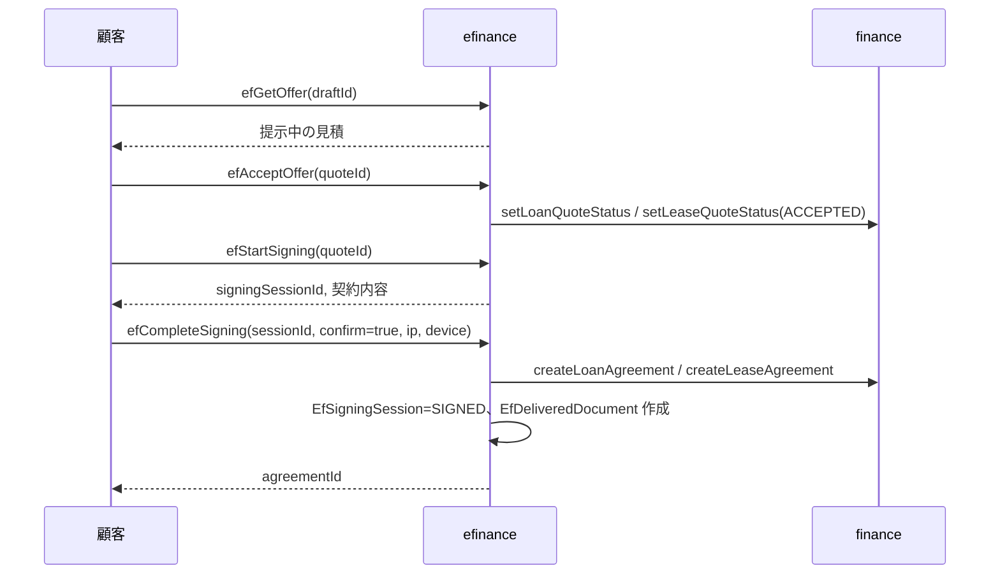
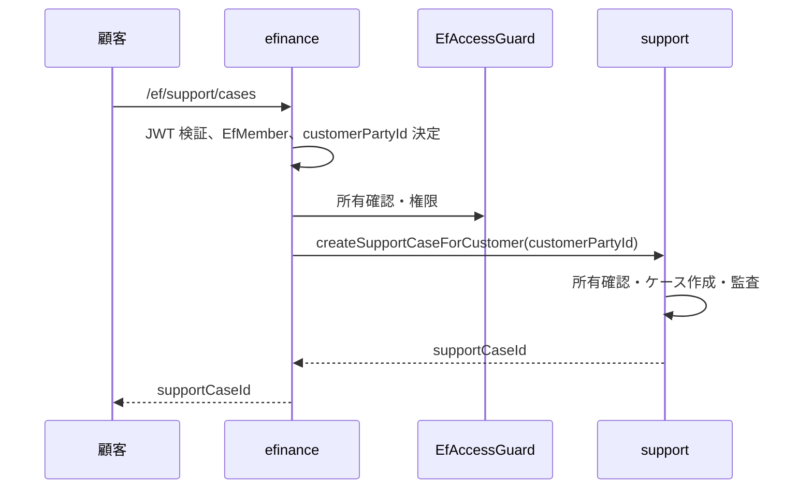

# Apache OFBiz eFinance 仕様書

`REQUIREMENTS_EFINANCE.md` の要件に対する設計。各 STEP の実装後に「実装」「テスト」「検証」を追記する。

> **状態：W0〜W7 の API・DB は実装済み（2026-10-23 更新）**。法人アカウント、`EfAuthFilter`、`EfStageEvent` / `NotificationAdapter`、管理画面、同意文書の版検証、再認証、`/portal` サンプル SPA、法人契約の照会所有確認、監査ログ閲覧、REST 自動結合テスト（CORS・エラーチェーンを含む）、JasperReports 契約 PDF・電子交付、`ESignatureAdapter`（クリック同意・外部 HTTP）、口座振替・振込案内、冪等性・重複下書き防止・レート制限、ファイルスキャン Adapter を追加した。最新のテストは **77 件成功（errors="0" / failures="0"）**。残る主要ギャップは W8 販売店ポータル、W9 提携先組込み・チャット。

## 進捗

| STEP | 内容 | 状態 |
|------|------|------|
| W0 | 基盤（2 章） | API/DB 実装済み（2026-10-22）。法人ロール管理・申込下書きの所有確認、`EfAuthFilter`、管理画面を追加 |
| W1 | 商品の紹介とシミュレーション（3 章） | 実装済み（2026-10-21） |
| W2 | Web での申込（4 章） | 実装済み（2026-10-23）。フォーム定義・外部ウイルススキャン接続は未完 |
| W3 | 本人確認と同意（5 章） | API 実装済み（2026-10-22）。同意文書 seed・一覧 API を追加。U6 連携は未完 |
| W4 | 仮審査と進み具合（6 章） | API 実装済み（2026-10-21）。段階イベント・通知は未完 |
| W5 | 電子契約と電子交付（7 章） | API 実装済み（2026-10-22）。KYC・同意ゲート、JasperReports PDF・電子交付、再認証、`ESignatureAdapter`（クリック同意・外部 HTTP）を追加 |
| W6 | マイページ（8 章） | API 実装済み（2026-10-22）。support ブリッジ、管理画面（KYC 審査・書類要請一覧・手続き依頼・ロック解除）を追加。タスク自動化は未実装 |
| W7 | 支払（9 章） | API/DB 実装済み（2026-10-23） |
| W8 | 販売店のポータル（10 章） | 設計（未着手） |
| W9 | 組込み・チャット（10 章） | 設計（未着手） |

### 実装・テスト・検証（2026-10-21）

| STEP | 実装した主なもの | テスト |
|------|------------------|--------|
| W0 | 26 entity のうち会員・法人・OTP・トークン・同意・監査 9 entity、20 サービス（同意文書一覧を含む）、REST 認証、法人サービス、管理画面の会員一覧・詳細・ロック解除 | `EfMemberTests` / `EfCorporateTests` / `EfAuthTests` |
| W1 | `EfProductPublication`、商品一覧・詳細、ローン・リースシミュレーション、REST 4 本 | `EfCatalogTests` |
| W2 | `EfApplicationDraft` / `EfDraftDocument` / `EfApplicationLink` / `EfFraudCheck`、下書き CRUD、書類、申込送信、REST 6 本 | `EfApplicationTests` |
| W3 | `EfKycCheck` / `EfKycImage`、KYC 開始・画像・提出・審査・確認判定、REST 4 本 | `EfKycTests` |
| W4 | `EfPreScreenResult` / `EfStageEvent` / `EfDocumentRequest`、仮審査、進捗、書類要請、REST 4 本 | `EfPreScreenTests` |
| W5 | `EfSigningSession` / `EfDeliveredDocument`、見積受理、署名、契約作成、交付書類、REST 6 本 | `EfContractTests` |
| W6 | `EfServiceRequest` / `EfNotificationSetting`、申込・契約照会、繰上返済、手続き、メッセージ、通知設定、REST 10 本、support 顧客 API ブリッジ 8 サービス | `EfMyPageTests` / `EfSupportTests` |
| W7 | `EfDirectDebitMandate`、口座振替依頼・照会、振込案内、担当者登録、REST 2 本、管理画面 | `EfPaymentTests` |

- 全体：**80 サービス**（`auth=true` 68、`auth=false` 12）、**26 entity**、**15 テストクラス / 77 テスト**。
- 実行：`.\gradlew.bat compileJava compileGroovy` 成功。`.\gradlew.bat "ofbiz --test component=efinance"` で **77 テスト、`errors="0"` / `failures="0"`**（`runtime/logs/test-results/efinancetests.xml`）。
- seed/demo：`data/EfinanceTypeData.xml`（状態・列挙・権限・`efinance-system`・同意文書）、`data/EfinanceDemoData.xml`（公開商品・デモ会員・サンプル申込・契約）、`testdef/data/EfinanceTestData.xml`（テスト会員・KYC/同意フィクスチャ）。
- **残作業**：W8 販売店ポータル、W9 提携先組込み・チャット。finance 全体回帰は 217 テスト成功、support はユーザー実行で OK。CORS・エラーチェーン・外部署名 HTTP アダプタ・W7 は自動テスト済み。

### 既知のギャップ（重要度順）

| # | 重要度 | 内容 | 影響 | 対応先 |
|---|:---:|------|------|--------|
| 1 | P0 | 法人アカウントのサービス・画面・所有確認が不十分 | 法人の申込・契約の権限管理ができない | W0 追加 → 2026-10-22 `EfCorporateServices` と管理画面で実装済み |
| 2 | P1 | `EfAuthFilter` によるリクエスト単位のトークン失効検証がない | 失効済みアクセストークンが期限まで使える | W0 追加 → 2026-10-22 rest-api 統合フィルタで実装済み |
| 3 | P1 | `EfStageEvent` が作成されていない | 進捗通知ができない | W4 追加 → 2026-10-22 `efGetApplicationStatus` から記録し、通知アダプタを実装済み |
| 4 | P1 | 監査ログの適用が一部サービスに限られる | 操作証跡が不足 | 2026-10-22 主要な業務サービス・法人・管理操作に適用済み。support 連携は support 側の監査に委ねる |
| 5 | P1 | 管理画面は会員と KYC 一覧のみ | 運用業務ができない | W6 追加 → 2026-10-22 KYC 審査・書類要請・手続き依頼・ロック解除を実装済み |
| 6 | P1 | `/portal` は仮ページのみ | 顧客サンプル画面の要件を満たさない | W6 追加 → 2026-10-22 サンプル SPA を実装済み |
| 7 | P1 | JasperReports 契約 PDF・交付書類の `contentId`、`ESignatureAdapter`（クリック同意）は実装済み。外部署名サービス連携は未実装 | 法的な本番運用には署名方式の確定が必要 | W5 追加 → 2026-10-22 PDF・contentId・Adapter を実装済み |
| 8 | P2 | `EfFormField` が未実装でフォーム定義が Java 固定 | 商品別の項目定義ができない | W2 追加 |
| 9 | P2 | ファイルスキャン Adapter がない | アップロードの安全性が保証できない | 2026-10-23 `FileScanAdapter` と既定 `EFSCAN_PENDING` を実装済み。外部スキャンサービス接続は未実装 |
| 10 | P2 | 重複下書き・冪等性・レート制限が不十分 | 二重申込・乱用のリスク | 2026-10-23 `EfRequestGuard` と `idempotencyKey` で下書き・送信・認証操作に対応済み |
| 11 | P2 | ローン残高が返済表の最終行の簡易計算 | finance の入金消込と一致しない場合がある | 2026-10-23 `getLoanAgreementBalance` 連携で解消済み |
| 12 | P2 | REST 結合テストは基本フロー・CORS・エラーチェーンを実装済み。外部署名・負荷試験は未実施 | API 契約の回帰は自動化済み | W6 テスト → 2026-10-22 実装済み |

**2026-10-22 に解消した項目**

- support 顧客 API ブリッジ（8 サービス・テスト付き）を追加した。
- 全顧客向けサービスに `efinanceCustomerPermission` を適用した（`permission-service` 56 件）。
- `EfToken` に JWT の `jti` を保存し、JWT の SHA-256 を `tokenHash` に保存するよう修正した。`efLogout` はアクセストークンも失効できる。
- `efRegisterMember` / `efRequestPasswordReset` の OTP・リセットトークンは system ユーザーにだけ返すよう修正した。
- 同意文書の seed と `efListConsentDocuments` を追加した。
- `efCompleteSigning` に KYC 確認と電子契約同意のゲートを追加した。
- `EfAccessGuard` の共通ヘルパーを追加した（所有確認・トークン確認）。

**2026-10-23 に解消した項目**

- ローンの `efGetContract` / `efSimulatePrepayment` が、返済表の最終行ではなく finance の `getLoanAgreementBalance` を参照するようにした。有効な `PaymentApplication` と取消されていない `LoanPrepayment` を正本とする。
- `EfRequestGuard` を追加し、下書き作成・申込送信の `idempotencyKey`、空の下書きの再利用、認証操作の DB レート制限を実装した。

---

## 1. 構成

### 1.1 ディレクトリ構成

```text
plugins/efinance/
  ofbiz-component.xml
  build.gradle
  api/efinance.rest.xml
  config/
    efinance.properties
    EfinanceUiLabels.xml
  data/
    EfinanceTypeData.xml       # seed
    EfinanceDemoData.xml       # demo
  entitydef/entitymodel.xml
  minilang/EfinancePermissionServices.xml
  servicedef/services.xml
  src/main/java/org/apache/ofbiz/efinance/
    account/      EfMemberServices.java
    application/  EfApplicationServices.java, EfPreScreenServices.java
    catalog/      EfCatalogServices.java
    contract/     EfContractServices.java
    kyc/          EfKycServices.java
    mypage/       EfMyPageServices.java
  src/main/groovy/org/apache/ofbiz/efinance/test/
  testdef/
    efinancetests.xml
    data/EfinanceTestData.xml
  webapp/
    efinanceadmin/   # 担当者向け管理画面
    portal/          # 顧客向けサンプル画面
  widget/
    EfinanceAdminScreens.xml
    EfinanceAdminForms.xml
```

### 1.2 `ofbiz-component.xml`

- `depends-on`：`finance`、`support`
- entity：`entitydef/entitymodel.xml`
- seed：`data/EfinanceTypeData.xml`
- demo：`data/EfinanceDemoData.xml`
- service：`servicedef/services.xml`
- test：`testdef/efinancetests.xml`
- webapp：
  - `efinanceadmin`：`/efinanceadmin`、`base-permission="OFBTOOLS,EFINANCE_ADMIN"`
  - `portal`：`/portal`（サンプル。認証は API 側で行う）

### 1.3 依存関係



- efinance は finance の公開サービスを `dispatcher.runSync` で呼ぶ。
- efinance は finance の計算・照会クラス（`FinanceInterestCalculator`、`LeaseCalculator`、`LeaseInquiryHelper` 等）を参照する。
- finance は efinance を参照しない。support も efinance を参照しない。
- efinance は ecommerce に依存しない。

### 1.4 設定（`config/efinance.properties`）

| キー | 既定 | 内容 |
|------|------|------|
| `efinance.token.expire.minutes` | 15 | アクセストークンの有効期間（分） |
| `efinance.refresh.expire.days` | 30 | 更新トークンの有効期間（日） |
| `efinance.otp.expire.minutes` | 10 | MFA OTP の有効期間 |
| `efinance.max.login.attempts` | 5 | ログイン失敗の上限 |
| `efinance.email.verify.expire.hours` | 24 | メール確認 OTP の有効期間 |
| `efinance.mfa.default` | NONE | 新規会員の既定 MFA 方式 |
| `efinance.system.userlogin` | efinance-system | 内部呼出しのシステムユーザー |
| `efinance.draft.expire.days` | 30 | 下書きの有効期間 |
| `efinance.upload.max.bytes` | 10485760 | アップロード上限（10MB） |
| `efinance.filescan.adapter` | `NoopFileScanAdapter` | ファイルスキャン Adapter。既定は `EFSCAN_PENDING` |
| `efinance.kyc.retention.years` | 7 | 本人確認記録の保存期間 |
| `esignature.adapter` | `ClickWrapSignatureAdapter` | 電子署名アダプタの実装クラス |
| `esignature.external.endpoint` | 空 | `ExternalSignatureAdapter` の署名 API URL |
| `esignature.external.apiKey` | 空 | 外部署名 API の `X-API-Key` |
| `esignature.external.timeout.seconds` | 10 | 外部署名 API のタイムアウト |
| `directdebit.adapter` | `ManualDirectDebitAdapter` | 口座振替アダプタ |
| `efinance.payment.bank.*` | サンプル銀行設定 | 振込先の銀行名・支店・口座種別・番号・名義 |

### 1.5 seed / demo / test データ

| ファイル | 用途 | 内容 |
|----------|------|------|
| `data/EfinanceTypeData.xml` | seed | 会員・法人・KYC・下書き・書類・署名・手続きの状態、列挙、権限、`efinance-system` |
| `data/EfinanceDemoData.xml` | demo | `EFPUB1`（`DEMO_LOANPROD1`）、`EFPUB2`（`DEMO_LEASEPROD1`）の公開設定。デモ会員 `DEMO_EF_CUST` / `demo-ef-customer`（パスワード `ofbiz`、KYC・同意済み）、サンプル申込、有効なローン契約、メッセージ、通知設定 |
| `testdef/data/EfinanceTestData.xml` | test | テスト会員 `TEST_EF_CUST` / `test-ef-customer`（パスワード `ofbiz`）。demo とは分離する |

- `efinance-system` は `SUPER` グループに所属し、finance・support の内部サービスを呼ぶ。
- システムユーザーのパスワードハッシュは seed に固定されている。本番では資格情報をローテーションする。

### 1.6 サービスの規約

すべての顧客向けサービスは、次の順に処理する。

1. 認証：JWT の `userLogin` が有効で、会員が `EFMBR_ACTIVE` であること。
2. 権限：`efinanceCustomerPermission` の `EFINANCE_CUSTOMER`（または管理者）を確認する。法人は対象契約の `EfCorporateUser` ロール（`roleApply` / `roleView` / `rolePayment` / `roleAdmin`）を確認する。
3. 所有確認：対象の下書き・申込・契約・KYC・書類がログイン会員（または法人）のものか確認する。
4. 再認証：重要操作では再認証トークンを検査する（**未実装**）。
5. 入力検証：必須・型・範囲・状態を検証する。
6. 業務呼出し：finance・support のサービスを `efinance-system` で呼ぶ。
7. 応答整形：顧客に見せてよい項目だけを返す。
8. 監査：`EfAuditLog` に記録する。

| サービス種別 | auth | permission-service | 例 |
|--------------|:---:|:---:|----|
| 公開（商品・シミュレーション・登録・ログイン） | false | なし | `efListProducts`、`efSimulateLoan`、`efLogin` |
| 顧客（要ログイン） | true | `efinanceCustomerPermission` | `efCreateDraft`、`efStartKyc`、`efGetContract` |
| 管理者 | true | `efinanceAdminPermission` | `reviewEfKycCheck`、`efCreateDocumentRequest` |
| 内部バッチ | true | なし（システム） | 将来の段階判定・通知 |

- 2026-10-22 時点で、顧客向け・support ブリッジのサービスに `efinanceCustomerPermission` を適用済み（`permission-service` 56 件）。`EfAuthFilter` によるリクエスト単位のトークン失効・会員ロック検証も実装済み。

### 1.7 エラーの形

rest-api の応答形式（`statusCode`・`statusDescription`・`errorMessage`）に従う。顧客向けメッセージは `EfinanceUiLabels` の多言語ラベルを使い、内部の `errorCode` と分ける。

| HTTP | 用途 | 例 |
|------|------|----|
| 400 | 入力エラー・状態不正 | `EfinanceValidationFailed`、`EfinanceDraftNotEditable` |
| 401 | 未認証・トークン失効 | `EfinanceTokenInvalid` |
| 403 | 権限・所有権エラー | `EfinanceDraftNotOwned`、`EfinanceKycNotOwned` |
| 404 | 対象なし | `EfinanceDraftNotFound`、`EfinanceContractNotFound` |
| 409 | 競合・重複 | `EfinanceDuplicateDraft`、`EfinanceSigningAlreadyActive` |
| 500 | 内部エラー | 汎用メッセージのみ。内部例外を返さない |

- finance・support のエラー文面をそのまま返さない。
- OTP・口座番号・個人情報をエラーに含めない。

---

## 2. データモデル

### 2.1 エンティティ一覧（26）

| エンティティ | パッケージ | 主キー | 主な項目 |
|--------------|-----------|--------|----------|
| `EfMember` | account | `partyId` | `userLoginId`、`memberTypeEnumId`、`statusId`、`emailVerifiedDate`、`phoneVerifiedDate`、`mfaMethodEnumId`、`lastLoginDate` |
| `EfCorporateAccount` | account | `corporatePartyId` | `adminMemberId`、`statusId`、`createdDate` |
| `EfCorporateUser` | account | `corporatePartyId` + `memberPartyId` + `fromDate` | `roleApply`、`roleView`、`rolePayment`、`roleAdmin`、`thruDate` |
| `EfOneTimeCode` | auth | `otpId` | `partyId`、`codeHash`、`purposeEnumId`、`expiresAt`、`attemptCount`、`usedDate` |
| `EfToken` | auth | `tokenId` | `tokenHash`、`partyId`、`userLoginId`、`deviceId`、`ipAddress`、`issuedAt`、`expiresAt`、`revokedDate`、`detail` |
| `EfRefreshToken` | auth | `refreshTokenId` | `tokenHash`、`partyId`、`userLoginId`、`deviceId`、`issuedAt`、`expiresAt`、`revokedDate`、`replacedByTokenId` |
| `EfConsentDocument` | consent | `documentId` | `documentTypeEnumId`、`version`、`language`、`contentId`、`effectiveDate`、`expiresDate` |
| `EfConsent` | consent | `consentId` | `partyId`、`documentId`、`consentDate`、`ipAddress`、`deviceId`、`revokedDate` |
| `EfProductPublication` | catalog | `publicationId` | `productId`、`fromDate`、`thruDate`、`displayOrder`、`targetEnumId`、`active` |
| `EfApplicationDraft` | application | `draftId` | `memberPartyId`、`corporatePartyId`、`productId`、`applicationTypeId`、`currentStep`、`totalSteps`、`draftJson`、`statusId`、`sourceEnumId`、`submittedApplicationId`、`submittedApplicationTypeId`、`expiresAt` |
| `EfDraftDocument` | application | `draftDocumentId` | `draftId`、`contentId`、`documentTypeEnumId`、`fileName`、`mimeTypeId`、`fileSizeBytes`、`scanStatus`、`uploadedDate` |
| `EfApplicationLink` | application | `linkId` | `draftId`、`memberPartyId`、`corporatePartyId`、`financeApplicationId`、`financeApplicationTypeId`、`linkedDate` |
| `EfFraudCheck` | application | `fraudCheckId` | `draftId`、`memberPartyId`、`checkDate`、`resultEnumId`、`triggeredRules`、`ipAddress`、`deviceId` |
| `EfKycCheck` | kyc | `kycCheckId` | `memberPartyId`、`kycSubjectPartyId`、`draftId`、`kycMethodEnumId`、`statusId`、`confirmerPartyId`、`confirmedDate`、`confirmerNote`、`adapterResultCode`、`adapterExternalId`、`expiresDate` |
| `EfKycImage` | kyc | `kycImageId` | `kycCheckId`、`contentId`、`imageTypeEnumId`、`scanStatus`、`uploadedDate` |
| `EfPreScreenResult` | application | `preScreenId` | `draftId`、`memberPartyId`、`preScreenDate`、`resultEnumId`、`triggeredRules`、`inputSummary` |
| `EfStageEvent` | application | `stageEventId` | `draftId`、`memberPartyId`、`fromStageEnumId`、`toStageEnumId`、`eventDate`、`notified` |
| `EfDocumentRequest` | application | `docRequestId` | `draftId`、`memberPartyId`、`documentTypeEnumId`、`reason`、`dueDate`、`statusId`、`requestedByPartyId`、`requestedDate`、`submittedContentId`、`submittedDate`、`scanStatus` |
| `EfSigningSession` | contract | `signingSessionId` | `draftId`、`memberPartyId`、`quoteId`、`quoteTypeId`、`statusId`、`consentIpAddress`、`consentDeviceId`、`consentDate`、`signatureMethodEnumId`、`signatureEvidenceHash`、`signedContentId`、`agreementId`、`agreementTypeId`、`expiresAt` |
| `EfDeliveredDocument` | contract | `deliveredDocId` | `draftId`、`memberPartyId`、`documentTypeEnumId`、`contentId`、`deliveredDate`、`consentId`、`viewedDate` |
| `EfDirectDebitMandate` | payment | `mandateId` | `memberPartyId`、`agreementId`、`agreementTypeId`、`financeContractId`、`bankName`、`branchName`、`accountTypeEnumId`、`accountNumber`（暗号化）、`accountNumberLast4`、`accountHolderName`、`statusId`、`adapterResult`、`startDate` |
| `EfIdempotencyRecord` | security | `recordId` | `subjectKey`、`operation`、`idempotencyKey`、`requestHash`、`statusId`、`resultEntityId`、`expiresDate` |
| `EfRateLimitBucket` | security | `bucketId` | `scope`、`subjectKey`、`windowStart`、`requestCount`、`lastUpdatedDate` |
| `EfServiceRequest` | mypage | `serviceRequestId` | `memberPartyId`、`draftId`、`agreementId`、`agreementTypeId`、`requestTypeEnumId`、`statusId`、`subject`、`content`、`requestData`、`requestedByPartyId`、`assignedToPartyId`、`requestedDate`、`completedDate`、`staffNotes` |
| `EfNotificationSetting` | mypage | `memberPartyId` + `notificationTypeEnumId` | `emailEnabled`、`smsEnabled`、`pushEnabled`、`lastModifiedDate` |
| `EfAuditLog` | audit | `auditLogId` | `partyId`、`actionEnumId`、`targetEntityName`、`targetEntityId`、`resultEnumId`、`ipAddress`、`deviceId`、`actionDate`、`detail` |

### 2.2 ER 図（主要な関係）



### 2.3 状態遷移

#### 会員（`EfMember.statusId`）

```text
EFMBR_PENDING --メール確認--> EFMBR_ACTIVE
EFMBR_ACTIVE  --失敗上限/管理者--> EFMBR_LOCKED
EFMBR_ACTIVE  --退会--> EFMBR_CLOSED
EFMBR_LOCKED  --管理者解除--> EFMBR_ACTIVE
EFMBR_LOCKED  --退会--> EFMBR_CLOSED
```

#### 申込下書き（`EfApplicationDraft.statusId`）

```text
EFDRF_EDITING --送信--> EFDRF_SUBMITTED
EFDRF_EDITING --撤回--> EFDRF_WITHDRAWN
EFDRF_EDITING --期限切れ--> EFDRF_EXPIRED
```

#### 本人確認（`EfKycCheck.statusId`）

```text
EFKYC_PENDING --提出--> EFKYC_SUBMITTED
EFKYC_SUBMITTED --確認済み--> EFKYC_VERIFIED
EFKYC_SUBMITTED --再提出依頼--> EFKYC_RESUBMIT
EFKYC_SUBMITTED --不可--> EFKYC_REJECTED
EFKYC_RESUBMIT --再提出--> EFKYC_SUBMITTED
```

#### 追加書類（`EfDocumentRequest.statusId`）

```text
EFDOCREQ_PENDING --提出--> EFDOCREQ_SUBMITTED
EFDOCREQ_SUBMITTED --受理--> EFDOCREQ_ACCEPTED
EFDOCREQ_SUBMITTED --差戻し--> EFDOCREQ_REJECTED
EFDOCREQ_REJECTED --再提出--> EFDOCREQ_SUBMITTED
```

#### 署名（`EfSigningSession.statusId`）

```text
EFSIG_PENDING --署名--> EFSIG_SIGNED
EFSIG_PENDING --辞退--> EFSIG_DECLINED
EFSIG_PENDING --期限切れ--> EFSIG_EXPIRED
```

#### 手続き依頼（`EfServiceRequest.statusId`）

```text
EFSVCREQ_RECEIVED --対応開始--> EFSVCREQ_IN_PROG
EFSVCREQ_RECEIVED --却下--> EFSVCREQ_REJECTED
EFSVCREQ_IN_PROG --完了--> EFSVCREQ_COMPLETE
EFSVCREQ_IN_PROG --却下--> EFSVCREQ_REJECTED
```

### 2.4 監査ログと保存

`EfAuditLog` の `actionEnumId` は主に次を使う。

| 区分 | 例 |
|------|----|
| 認証 | `REGISTER`、`EMAIL_VERIFY`、`LOGIN`、`LOGIN_FAIL`、`MFA_VERIFY`、`LOGOUT`、`PASSWORD_RESET`、`TOKEN_ISSUE`、`TOKEN_REVOKE` |
| 同意 | `CONSENT` |
| 申込 | `DRAFT_CREATE`、`DRAFT_SAVE`、`DRAFT_SUBMIT`、`DRAFT_WITHDRAW`、`DOC_UPLOAD`、`DOC_DELETE` |
| KYC | `KYC_START`、`KYC_SUBMIT`、`KYC_REVIEW` |
| 仮審査・段階 | `PRESCREEN`、`STAGE_CHANGE`、`DOC_REQ_CREATE`、`DOC_REQ_SUBMIT` |
| 契約 | `OFFER_ACCEPT`、`SIGN_START`、`SIGN_COMPLETE`、`DOC_DELIVER` |
| マイページ | `SVCREQ_CREATE`、`MSG_SEND` |

- 監査ログにはメッセージ本文・OTP・口座番号を保存しない。
- 監査ログの保存期間は 7 年（設計値）。削除・匿名化のバッチは未実装。
- 監査ログの閲覧は `EFINANCE_ADMIN` のみ（管理画面は未実装）。

---

## 3. 認証・認可

### 3.1 登録とメール確認



- 現状はテスト用に `verificationToken` を返す。本番では `NotificationAdapter` でメール送信し、API 応答から削除する。
- パスワードは `HashCrypt`（SHA）で保存する。将来は PBKDF2 へ移行する。

### 3.2 ログインと MFA



### 3.3 トークンのライフサイクル

| 項目 | 現状（2026-10-22） | 目標 |
|------|------|------|
| アクセストークン | `JWTManager.createJwt` に `jti` を追加し、JWT の SHA-256 を `EfToken.tokenHash` に保存する | リクエスト時に `EfToken` を照合して失効を検証する |
| 更新トークン | ランダム文字列の SHA-256 を `EfRefreshToken` に保存。更新時にローテーション | 端末単位の失効・再利用検知を追加 |
| 失効 | `efLogout` は更新トークンと、指定されたアクセストークンを失効できる。`efLogoutAll` は全トークンを失効する | 全リクエストで `EfToken` の失効・有効期限を検証 |
| 会員ロック | ログイン時に状態を確認 | API 呼出し時にも確認 |
| 再認証 | 未実装 | 重要操作の前に短命の再認証トークンを要求 |

### 3.4 `EfAuthFilter`（実装済み） / `EfAccessGuard`（共通ヘルパー実装済み）

**`EfAccessGuard`（サービス層）**

`org.apache.ofbiz.efinance.security.EfAccessGuard` に次の共通判定を実装した。

- `isActiveMember(Delegator, GenericValue userLogin)`
- `isAccessTokenActive(Delegator, String jwt)`
- `isDraftOwned(Delegator, String draftId, GenericValue userLogin)`
- `isContractOwned(Delegator, String agreementId, String agreementTypeId, GenericValue userLogin)`
- `isKycOwned(...)`、`isServiceRequestOwned(...)`、`isDeliveredDocumentOwned(...)`
- `isDocumentRequestOwned(...)`
- `hasCorporateRole(...)` / `isCorporateAdmin(...)`
- `isDraftAccessible(...)`
- `isReauthTokenActive(...)` / `consumeReauthToken(...)`
- `sha256(String)`

- 法人の `EfCorporateUser` ロール確認は `isDraftAccessible` で実装済み。法人契約は `isContractAccessible` で `roleView`（支払操作は `rolePayment`）を確認する。

**`EfAuthFilter`（rest-api 統合フィルタ）**

- `plugins/rest-api` の `org.apache.ofbiz.ws.rs.security.auth.EfAuthFilter` が `/ef/` の REST リクエストを検証する。
- JWT 署名検証は rest-api の `APIAuthFilter` が行い、その後段で `EfRequestValidator` が `EfToken` の失効・有効期限と `EfMember` のロック状態を確認する。
- efinance は rest-api にコンパイル依存しない。フィルタは `EfRequestValidator` をリフレクションで呼び出す。
- トークンなしの `auth=false` エンドポイントは従来どおり通過する。

- サービス内の所有確認（`EfAccessGuard`）は引き続き各サービスで行う。

### 3.5 再認証

| 操作 | 再認証 |
|------|:---:|
| 契約の締結 | 必須 |
| 口座振替の登録（W7） | 必須 |
| 繰上返済の申込 | 必須 |
| 住所・連絡先の変更 | 必須 |
| パスワード変更・リセット | 必須（現在のパスワードまたは OTP） |
| 通常の参照・下書き保存 | 不要 |

- 実装済み。`efReauthenticate` が 5 分間のワンタイム再認証トークンを発行し、`efCompleteSigning` / `efRequestPrepayment` / `efRequestModification` / `efRequestExpiryOption` / `efRequestProfileChange` が検証・消費する。
- トークンは `EfToken.detail=REAUTH` として保存し、アクセストークンとしては利用できない。

### 3.6 ロックとレート制限

- ログイン失敗が `efinance.max.login.attempts`（5）を超えると `EFMBR_LOCKED`。管理者が解除する。
- 仮審査は同一下書き 1 時間 5 回まで。超過時は `EFPRE_CONSULT`。
- 登録・ログイン・パスワード再設定・MFA は、DB の `EfRateLimitBucket` による固定ウィンドウ制限を行う（`EfRequestGuard.checkRateLimit`、既定値は `efinance.properties`）。
- 下書き作成・申込送信も利用者単位で制限する。
- 公開シミュレーションの IP レート制限は未実装。

### 3.7 法人の権限

| ロール | 説明 |
|--------|------|
| `EFCORP_APPLY`（`roleApply=Y`） | 法人の申込を作成・送信できる |
| `EFCORP_VIEW`（`roleView=Y`） | 法人の申込・契約を参照できる |
| `EFCORP_PAYMENT`（`rolePayment=Y`） | 支払・口座振替・繰上返済を申し込める |
| `EFCORP_ADMIN`（`roleAdmin=Y`） | 法人の担当者・権限を管理できる |

- `EfCorporateServices` で法人作成・担当者追加・権限更新・一覧を実装済み。所有確認は `EfAccessGuard.isCorporateAdmin` / `hasCorporateRole` を使う。管理画面からも参照できる。

### 3.8 個人情報・マスキング

- 顧客 API は、担当者連絡先・内部メモ・SLA 内部値・審査スコアを返さない。
- 口座番号は下 4 桁だけ表示する（W7）。
- 監査ログ・エラーメッセージに PII を出さない。
- 本人確認画像は管理者だけが閲覧できる（管理画面は未実装）。
- 保存期間は、本人確認 7 年、監査 7 年、下書き 30 日を既定とする。

---

## 4. STEP W0 — 基盤

### 4.1 エンティティ（詳細）

| エンティティ | 主な項目 | 関係・制約 |
|--------------|----------|------------|
| `EfMember` | `partyId`、`userLoginId`、`memberTypeEnumId`、`statusId`、`emailVerifiedDate`、`phoneVerifiedDate`、`mfaMethodEnumId`、`lastLoginDate`、`createdDate`、`lastModifiedDate` | Party 1:1、UserLogin 1:1、StatusItem |
| `EfCorporateAccount` | `corporatePartyId`、`adminMemberId`、`statusId`、`createdDate` | Party（PARTY_GROUP）、StatusItem |
| `EfCorporateUser` | `corporatePartyId`、`memberPartyId`、`roleApply`、`roleView`、`rolePayment`、`roleAdmin`、`fromDate`、`thruDate` | EfCorporateAccount、Party |
| `EfOneTimeCode` | `otpId`、`partyId`、`codeHash`、`purposeEnumId`、`expiresAt`、`attemptCount`、`usedDate`、`createdDate` | Party |
| `EfToken` | `tokenId`、`tokenHash`、`partyId`、`userLoginId`、`deviceId`、`ipAddress`、`issuedAt`、`expiresAt`、`revokedDate`、`detail` | Party |
| `EfRefreshToken` | `refreshTokenId`、`tokenHash`、`partyId`、`userLoginId`、`deviceId`、`issuedAt`、`expiresAt`、`revokedDate`、`replacedByTokenId` | Party、自己参照 |
| `EfConsentDocument` | `documentId`、`documentTypeEnumId`、`version`、`language`、`contentId`、`effectiveDate`、`expiresDate` | Content |
| `EfConsent` | `consentId`、`partyId`、`documentId`、`consentDate`、`ipAddress`、`deviceId`、`revokedDate` | Party、EfConsentDocument |
| `EfAuditLog` | `auditLogId`、`partyId`、`actionEnumId`、`targetEntityName`、`targetEntityId`、`resultEnumId`、`ipAddress`、`deviceId`、`actionDate`、`detail` | Party |

### 4.2 サービス（14）

| サービス | auth | 主な IN / OUT | 内容 |
|----------|:---:|---------------|------|
| `efRegisterMember` | false | IN: email, password, firstName, lastName, phone, memberType / OUT: partyId, userLoginId, verificationToken（system のみ） | 会員登録。Party・Person・UserLogin・EfMember(PENDING)・OTP 作成 |
| `efVerifyEmail` | false | IN: token / OUT: success | OTP 検証、EfMember を ACTIVE に |
| `efLogin` | false | IN: userLoginId, password, deviceId, ipAddress / OUT: accessToken, refreshToken, mfaRequired, mfaTempToken, memberStatus | パスワード検証、MFA 判定、トークン発行 |
| `efVerifyMfa` | false | IN: tempToken, otpCode, deviceId, ipAddress / OUT: accessToken, refreshToken | MFA 検証、トークン発行 |
| `efRefreshToken` | false | IN: refreshToken, deviceId / OUT: accessToken, refreshToken | 更新トークンのローテーション |
| `efLogout` | true | IN: refreshToken, accessToken | 更新・アクセストークン失効 |
| `efLogoutAll` | true | – | 会員の全トークン失効 |
| `efRequestPasswordReset` | false | IN: email / OUT: resetToken（system のみ） | 再設定 OTP 発行 |
| `efResetPassword` | false | IN: token, newPassword | パスワード更新、全トークン失効 |
| `efGetProfile` | true | OUT: member | 会員プロフィール |
| `efAcceptConsent` | true | IN: documentId, ipAddress, deviceId | 同意記録 |
| `efListConsents` | true | OUT: consents | 同意一覧 |
| `efListConsentDocuments` | true | OUT: documents | 有効な同意文書一覧 |
| `efinanceAdminPermission` | true | OUT: hasPermission, failMessage | 管理者権限チェック |

### 4.3 REST

| メソッド | パス | サービス | auth |
|----------|------|----------|:---:|
| POST | `/ef/auth/register` | `efRegisterMember` | false |
| POST | `/ef/auth/verify-email` | `efVerifyEmail` | false |
| POST | `/ef/auth/login` | `efLogin` | false |
| POST | `/ef/auth/verify-mfa` | `efVerifyMfa` | false |
| POST | `/ef/auth/refresh` | `efRefreshToken` | false |
| POST | `/ef/auth/reauth` | `efReauthenticate` | true |
| POST | `/ef/auth/logout` | `efLogout` | true |
| POST | `/ef/auth/logout-all` | `efLogoutAll` | true |
| POST | `/ef/auth/password-reset` | `efRequestPasswordReset` | false |
| POST | `/ef/auth/password-reset/confirm` | `efResetPassword` | false |
| GET | `/ef/me` | `efGetProfile` | true |
| GET/POST | `/ef/consents` | `efListConsents` / `efAcceptConsent` | true |
| GET | `/ef/consent-documents` | `efListConsentDocuments` | true |

### 4.4 画面

- `/portal`：`PortalHome`。商品一覧・シミュレーション・ログイン/登録・申込・KYC・見積/署名・マイページを確認できるサンプル SPA。

- 管理画面：会員一覧・詳細・ロック解除、KYC 一覧・審査、追加書類要請一覧、手続き依頼一覧・更新、口座振替一覧・登録、監査ログ一覧（`/efinanceadmin/control/FindEfAuditLog`）。

### 4.5 テスト

- `EfMemberTests`：登録→メール確認→ログイン、誤パスワード、画面パース。
- `EfCorporateTests`：法人アカウント・ロール管理、法人契約の照会所有確認。
- `EfAdminTests`：会員ロック解除、手続き依頼更新、監査ログ一覧。
- `EfRestIntegrationTests`：公開商品、ログイン、Bearer 認証、無効トークンの 401。

### 4.6 既知のギャップ

- 法人のサービス・画面・申込下書き・契約照会の所有確認は実装済み。法人単位の集計は未実装。
- `EfAuthFilter` によるリクエスト単位のトークン失効・会員ロック検証は実装済み。
- 再認証は実装済み。`efReauthenticate` と `EfToken.detail=REAUTH` を使う。
- 同意文書の版検証（申込送信時の必須同意チェック）は実装済み。
- 会員ロック解除、KYC 審査、手続き依頼、監査ログ閲覧は管理画面に実装済み。

---

## 5. STEP W1 — 商品の紹介とシミュレーション

### 5.1 エンティティ

| エンティティ | 主な項目 |
|--------------|----------|
| `EfProductPublication` | `publicationId`、`productId`、`fromDate`、`thruDate`、`displayOrder`、`targetEnumId`（ALL / PERSONAL / CORPORATE）、`active` |

### 5.2 サービス

| サービス | auth | 主な IN / OUT | 内容 |
|----------|:---:|---------------|------|
| `efListProducts` | false | IN: targetEnumId / OUT: products | 公開中の商品一覧 |
| `efGetProduct` | false | IN: productId / OUT: product | 商品詳細（ローン・リース項目） |
| `efSimulateLoan` | false | IN: productId, principalAmount, termMonths, repaymentMethod, annualInterestRate / OUT: monthlyPayment, totalPayment, totalInterest, effectiveAnnualRate, schedule | 元利均等・元金均等の返済予定。保存しない |
| `efSimulateLease` | false | IN: productId, acquisitionCost, termMonths, taxRate / OUT: monthlyLeaseAmount, totalLeaseAmount, totalTax, calcInterestRate, schedule | `LeaseCalculator` によるリース料。保存しない |

### 5.3 計算と検証

- ローン：`FinancialProduct.defaultAnnualInterestRate` を既定に、入力レートを優先。`principalAmount` と `termMonths` の範囲を検証。通貨の端数処理は `FinanceInterestCalculator.resolveScale` / `resolveRoundingMode` を使う。
- リース：`FinancialProductLease.defaultMonthlyRateFactor` または `defaultCalcInterestRate` を使う。`residualValueRate`、`paymentTimingEnumId`、`taxRate` を反映。
- 結果には `EfinanceSimulationDisclaimer` を付ける。
- 公開シミュレーションのレート制限は未実装。

### 5.4 REST

| メソッド | パス | サービス |
|----------|------|----------|
| GET | `/ef/products` | `efListProducts` |
| GET | `/ef/products/{productId}` | `efGetProduct` |
| POST | `/ef/simulate/loan` | `efSimulateLoan` |
| POST | `/ef/simulate/lease` | `efSimulateLease` |

### 5.5 テスト

- `EfCatalogTests`：商品一覧、存在しない商品、ローン基本、範囲外、リース基本。

### 5.6 既知のギャップ

- 公開シミュレーションの IP レート制限なし。
- 公開商品の管理画面なし。
- 実質年率は簡易表示で、手数料を含む APR 計算は未実装。
- 商品の広告表示項目（金利幅・返済例）は未実装。

---

## 6. STEP W2 — Web での申込

### 6.1 エンティティ

| エンティティ | 主な項目 |
|--------------|----------|
| `EfApplicationDraft` | `draftId`、`memberPartyId`、`corporatePartyId`、`productId`、`applicationTypeId`、`currentStep`、`totalSteps`、`draftJson`、`statusId`、`sourceEnumId`、`submittedApplicationId`、`submittedApplicationTypeId`、`expiresAt`、`createdDate`、`lastModifiedDate` |
| `EfDraftDocument` | `draftDocumentId`、`draftId`、`contentId`、`documentTypeEnumId`、`fileName`、`mimeTypeId`、`fileSizeBytes`、`scanStatus`、`uploadedDate` |
| `EfApplicationLink` | `linkId`、`draftId`、`memberPartyId`、`corporatePartyId`、`financeApplicationId`、`financeApplicationTypeId`、`linkedDate` |
| `EfFraudCheck` | `fraudCheckId`、`draftId`、`memberPartyId`、`checkDate`、`resultEnumId`、`triggeredRules`、`ipAddress`、`deviceId` |

### 6.2 入力ステップ

| 種別 | ステップ | 主な項目 |
|------|----------|----------|
| LOAN | 1. product | productId、principalAmount、termMonths、repaymentMethod |
| LOAN | 2. applicant | firstName、lastName、birthDate、postalCode、prefecture、city、address1、employerName、annualIncome、residenceType |
| LOAN | 3. agreement | confirmTerms、confirmPrivacy |
| LEASE | 1. product | productId、termMonths |
| LEASE | 2. asset | assetName、fixedAssetTypeId、estimatedAcquisitionCost、supplierName |
| LEASE | 3. applicant | companyName、representativeName、代表者生年月日、会社情報 |
| LEASE | 4. agreement | confirmTerms、confirmPrivacy |

- 現在は `EfApplicationServices` の Java 固定定義。`EfFormField` の seed 定義は未実装。
- `draftJson` はステップ番号をキーにした JSON。Jackson で読み書きする。

### 6.3 サービス

| サービス | auth | 主な IN / OUT | 内容 |
|----------|:---:|---------------|------|
| `efGetApplicationForm` | false | IN: productId, applicationTypeId / OUT: steps, totalSteps | ステップ定義 |
| `efCreateDraft` | true | IN: productId, applicationTypeId, sourceEnumId, idempotencyKey / OUT: draftId, expiresAt, existingDraft, replayed | 下書き作成（空の下書きを再利用） |
| `efSaveDraft` | true | IN: draftId, step, stepData / OUT: stepValid, validationErrors | ステップ保存・検証 |
| `efGetDraft` | true | IN: draftId / OUT: draft | 下書き＋書類 |
| `efListDrafts` | true | OUT: drafts | 自分の編集中下書き |
| `efWithdrawDraft` | true | IN: draftId | 撤回 |
| `efUploadDraftDocument` | true | IN: draftId, documentTypeEnumId, fileName, contentType, uploadedFile / OUT: draftDocumentId, scanStatus | `FileScanAdapter` で検査し、`createContentFromUploadedFile` で保存 |
| `efDeleteDraftDocument` | true | IN: draftDocumentId | 書類削除 |
| `efSubmitApplication` | true | IN: draftId, ipAddress, deviceId, idempotencyKey / OUT: financeApplicationId, financeApplicationTypeId, fraudResult, replayed | 全検証→不正検知→finance 申込作成→リンク |

### 6.4 送信フロー



- finance の申込は `LOANAPP_RECEIVED` / `LEASEAPP_RECEIVED` で作成する。
- 提出（SUBMITTED）への変更は担当者が finance 画面で行う（既定は手動）。
- 下書き作成は、同じ会員・商品・申込種別の未入力（`draftJson={}`）の編集中下書きを再利用し、連打による重複作成を防ぐ。
- `efCreateDraft` / `efSubmitApplication` は任意の `idempotencyKey` を受け付ける。完了済みの同じキーと同じ内容の再実行は、作成済みの `draftId` / `financeApplicationId` を返す。
- 異なる内容で同じキーを再利用した場合は `EfIdempotencyRecord` により競合として拒否する。処理中・失敗の状態も記録する。
- 下書き書類・KYC 画像・追加書類のアップロードは `FileScanAdapter` を通す。既定の `NoopFileScanAdapter` は `EFSCAN_PENDING` を返し、`BasicFileScanAdapter` は EICAR テスト文字列を `EFSCAN_INFECTED` として拒否する。

### 6.5 不正検知

- 現在は 24 時間の `EfApplicationLink` 件数が 3 件超で `EFFRAUD_BLOCK`。
- 端末・IP・電話・住所・口座・入力不整合の規則は未実装。
- 仮審査の繰返しは W4 のレート制限で一部対応。

### 6.6 REST

| メソッド | パス | サービス |
|----------|------|----------|
| GET | `/ef/applications/form` | `efGetApplicationForm` |
| GET/POST | `/ef/applications/drafts` | `efListDrafts` / `efCreateDraft` |
| GET/PUT/DELETE | `/ef/applications/drafts/{draftId}` | `efGetDraft` / `efSaveDraft` / `efWithdrawDraft` |
| POST | `/ef/applications/drafts/{draftId}/documents` | `efUploadDraftDocument` |
| DELETE | `/ef/applications/drafts/{draftId}/documents/{draftDocumentId}` | `efDeleteDraftDocument` |
| POST | `/ef/applications/drafts/{draftId}/submit` | `efSubmitApplication` |

- `POST /ef/applications/drafts` と `/submit` は本文に任意の `idempotencyKey` を受け付ける。同じキーで同じ内容を再送した場合は元の結果を返し、別内容は競合として拒否する。

### 6.7 テスト

- `EfApplicationTests`：フォーム、下書き作成・保存、重複下書き再利用、`idempotencyKey` による作成・送信の再実行、撤回、送信（ローン）、一覧。

### 6.8 既知のギャップ

- `EfFormField` 未実装。
- ファイルスキャン Adapter は実装済み。既定の `NoopFileScanAdapter` は安全側で `EFSCAN_PENDING` を返し、外部ウイルススキャンサービスとの接続は未実装。
- 住所・法人番号の照会 Adapter 未実装。
- AI 書類読取（U8）未実装。
- 公開シミュレーションの IP レート制限は未実装。
- 法人契約の照会所有確認は実装済み（`EfAccessGuard.isContractAccessible`）。

---

## 7. STEP W3 — 本人確認と同意

### 7.1 エンティティ

| エンティティ | 主な項目 |
|--------------|----------|
| `EfKycCheck` | `kycCheckId`、`memberPartyId`、`kycSubjectPartyId`、`draftId`、`kycMethodEnumId`、`statusId`、`confirmerPartyId`、`confirmedDate`、`confirmerNote`、`adapterResultCode`、`adapterExternalId`、`expiresDate`、`createdDate`、`lastModifiedDate` |
| `EfKycImage` | `kycImageId`、`kycCheckId`、`contentId`、`imageTypeEnumId`、`scanStatus`、`uploadedDate` |
| `EfConsentDocument` | `documentId`、`documentTypeEnumId`、`version`、`language`、`contentId`、`effectiveDate`、`expiresDate` |
| `EfConsent` | `consentId`、`partyId`、`documentId`、`consentDate`、`ipAddress`、`deviceId`、`revokedDate` |

### 7.2 KYC サービス

| サービス | auth | 主な IN / OUT | 内容 |
|----------|:---:|---------------|------|
| `efStartKyc` | true | IN: draftId, kycMethodEnumId / OUT: kycCheckId | PENDING 作成、保存期限設定 |
| `efUploadKycImage` | true | IN: kycCheckId, imageTypeEnumId, fileName, contentType, uploadedFile / OUT: kycImageId, scanStatus | 画像アップロード。`FileScanAdapter` で検査 |
| `efSubmitKyc` | true | IN: kycCheckId | PENDING→SUBMITTED |
| `efGetKycStatus` | true | IN: kycCheckId / draftId / OUT: kycCheck, images | 状態・画像一覧 |
| `reviewEfKycCheck` | true | IN: kycCheckId, statusId, confirmerNote | 管理者審査（VERIFIED/RESUBMIT/REJECTED） |
| `efIsKycVerified` | true | IN: subjectPartyId / draftId / OUT: verified, kycCheckId | 契約前の確認 |

### 7.3 同意

- 同意文書は `EfConsentDocument`（種類・版・言語・Content・有効期間）で管理する。
- `efAcceptConsent` は documentId を受け取り、`EfConsent` に日時・IP・端末を記録する。
- 必要な同意：利用規約、個人情報、信用情報照会、電子交付、電子契約。
- **現状（2026-10-22）**：`EfConsentDocument` の seed（利用規約・個人情報・信用情報・電子交付・電子契約の version 1.0）と `efListConsentDocuments` を追加した。`efCompleteSigning` は電子契約同意の有無を確認する。申込送信時の必須同意チェックと版の一致検証は未実装。
- 追加予定：`efGetConsentDocument`、`efValidateConsents`、同意撤回 API。

### 7.4 審査との連携

- 本来は KYC 確認済みを finance の `FinUwExternalInfo`（U6、`infoTypeId=IDENTITY`）に記録し、契約時に `FINUWCND_KYC` を満たすことを確認する。
- **現状**：`recordKycToUnderwriting` は TODO スタブ。`efCompleteSigning` は `EfKycCheck` の VERIFIED を確認し、未確認なら契約を作成しない（2026-10-22 追加）。
- 本人確認記録の保存期間は 7 年（既定）。画像閲覧は管理者のみ（画面未実装）。

### 7.5 REST

| メソッド | パス | サービス |
|----------|------|----------|
| POST | `/ef/kyc` | `efStartKyc` |
| GET | `/ef/kyc/{kycCheckId}` | `efGetKycStatus` |
| POST | `/ef/kyc/{kycCheckId}/images` | `efUploadKycImage` |
| POST | `/ef/kyc/{kycCheckId}/submit` | `efSubmitKyc` |

### 7.6 テスト

- `EfKycTests`：開始・提出、スタッフ確認（VERIFIED）、再提出、未確認判定。

### 7.7 既知のギャップ

- 申込送信時の必須同意チェック・同意文書の版一致検証。
- `FinUwExternalInfo`（U6）連携。
- KYC 審査画面・画像閲覧権限。
- 再認証（契約締結前）。

---

## 8. STEP W4 — 仮審査と進み具合

### 8.1 エンティティ

| エンティティ | 主な項目 |
|--------------|----------|
| `EfPreScreenResult` | `preScreenId`、`draftId`、`memberPartyId`、`preScreenDate`、`resultEnumId`、`triggeredRules`、`inputSummary` |
| `EfStageEvent` | `stageEventId`、`draftId`、`memberPartyId`、`fromStageEnumId`、`toStageEnumId`、`eventDate`、`notified` |
| `EfDocumentRequest` | `docRequestId`、`draftId`、`memberPartyId`、`documentTypeEnumId`、`reason`、`dueDate`、`statusId`、`requestedByPartyId`、`requestedDate`、`submittedContentId`、`submittedDate`、`scanStatus` |

### 8.2 仮審査ルール（現行）

| ルール | 条件 | 結果 |
|--------|------|------|
| `RULE_AMOUNT_RANGE` | 金額が商品の min/max 外 | UNLIKELY |
| `RULE_TERM_RANGE` | 期間が商品の min/max 外 | UNLIKELY |
| `RULE_INCOME_LOW` | 年収 < 申込額 × 0.2 | UNLIKELY |
| `RULE_INCOME_MODERATE` | 年収 < 申込額 × 0.4 | CONSULT |
| レート制限 | 同一下書き 1 時間 5 回超 | CONSULT |

- 顧客に返すのは `LIKELY` / `CONSULT` / `UNLIKELY` と案内文だけ。`triggeredRules`・スコアは返さない。
- finance U3/U4 のルールエンジンは未実装のため、efinance 独自の簡易ルールで代替している。

### 8.3 進捗段階（現行）

| `EF_STAGE` | 意味 | 判定 |
|------------|------|------|
| `EF_STAGE_RECEIVED` | 受付 | 下書き未送信、または申込 RECEIVED |
| `EF_STAGE_DOC_REQUEST` | 追加の書類のお願い | `EfDocumentRequest` が PENDING |
| `EF_STAGE_REVIEWING` | 審査中 | 申込 SUBMITTED、審査 IN_REVIEW |
| `EF_STAGE_RESULT` | 結果のご連絡 | 審査 APPROVED / REJECTED |
| `EF_STAGE_OFFER` | ご契約の手続き | 見積 PRESENTED |
| `EF_STAGE_CONTRACTED` | ご契約済み | 契約 CONTRACTED / ACTIVE |

- 設計時の `EF_STAGE_UNDER_REVIEW` は 20 文字制限のため `EF_STAGE_REVIEWING` に変更した。
- `EfStageEvent` は `efGetApplicationStatus` がステージ変化を検出したときに 1 件だけ作成する（同じステージでは重複しない）。
- `NotificationAdapter` の既定実装 `DefaultNotificationAdapter` が `CommunicationEvent` を記録する。外部メール・SMS は `efinance.properties` の `notification.adapter` で差し替える。

### 8.4 サービス

| サービス | auth | 主な IN / OUT | 内容 |
|----------|:---:|---------------|------|
| `efPreScreen` | true | IN: draftId / OUT: result, guidance, disclaimer | 簡易仮審査 |
| `efGetApplicationStatus` | true | IN: draftId / OUT: stageEnumId, stageDescription, nextAction, applicationStatus | finance 状態→ステージ。ステージ変化時に `EfStageEvent` を記録 |
| `efListStageEvents` | true | IN: draftId / OUT: stageEvents | 進捗タイムライン |
| `efCreateDocumentRequest` | true | IN: draftId, documentTypeEnumId, reason, dueDate / OUT: docRequestId | 管理者が書類要請 |
| `efListDocumentRequests` | true | IN: draftId / OUT: docRequests | 書類要請一覧 |
| `efSubmitRequestedDocument` | true | IN: docRequestId, fileName, contentType, uploadedFile / OUT: scanStatus | 顧客が提出。`FileScanAdapter` で検査 |

### 8.5 REST

| メソッド | パス | サービス |
|----------|------|----------|
| POST | `/ef/applications/drafts/{draftId}/prescreen` | `efPreScreen` |
| GET | `/ef/applications/drafts/{draftId}/status` | `efGetApplicationStatus` |
| GET | `/ef/applications/drafts/{draftId}/stage-events` | `efListStageEvents` |
| GET | `/ef/applications/drafts/{draftId}/document-requests` | `efListDocumentRequests` |
| POST | `/ef/applications/drafts/{draftId}/document-requests/{docRequestId}/submit` | `efSubmitRequestedDocument` |


- `EfPreScreenTests`：LIKELY / CONSULT / UNLIKELY、審査ステージ、送信後ステージ、書類要請の作成・一覧・提出、`EfStageEvent` の重複防止と通知。

### 8.7 既知のギャップ

- ECA・バッチによる通知の高度化（現状はステージ照会時の同期通知）。
- 総量規制（U7）の目安。
- 書類要請の管理者画面。
- 段階の期限・次アクションの高度化。

---

## 9. STEP W5 — 電子契約と電子交付

### 9.1 エンティティ

| エンティティ | 主な項目 |
|--------------|----------|
| `EfSigningSession` | `signingSessionId`、`draftId`、`memberPartyId`、`quoteId`、`quoteTypeId`、`statusId`、`consentIpAddress`、`consentDeviceId`、`consentDate`、`signatureMethodEnumId`、`signatureEvidenceHash`、`signedContentId`、`agreementId`、`agreementTypeId`、`expiresAt`、`createdDate` |
| `EfDeliveredDocument` | `deliveredDocId`、`draftId`、`memberPartyId`、`documentTypeEnumId`、`contentId`、`deliveredDate`、`consentId`、`viewedDate` |

### 9.2 フロー



### 9.3 サービス

| サービス | auth | 主な IN / OUT | 内容 |
|----------|:---:|---------------|------|
| `efGetOffer` | true | IN: draftId / OUT: offer, quoteId, quoteTypeId | 提示中の見積 |
| `efAcceptOffer` | true | IN: draftId, quoteId, quoteTypeId / OUT: acceptedQuoteId | 見積受理 |
| `efStartSigning` | true | IN: draftId, quoteId, quoteTypeId / OUT: signingSessionId, contractSummary | 署名セッション作成 |
| `efCompleteSigning` | true | IN: signingSessionId, confirmContent, ipAddress, deviceId / OUT: agreementId, agreementTypeId | 同意記録→契約作成 |
| `efListDocuments` | true | IN: draftId / OUT: documents | 交付書類一覧 |
| `efDownloadDocument` | true | IN: deliveredDocId / OUT: document, contentId, mimeTypeId, fileName, textData, contentBase64 | 交付書類取得（PDF は Base64） |

### 9.4 状態と失敗時

- `EFSIG_PENDING` → `EFSIG_SIGNED` / `EFSIG_DECLINED` / `EFSIG_EXPIRED`。
- 署名セッションは 24 時間で失効。
- `confirmContent=true` でなければ署名できない。
- finance の契約作成が失敗した場合、セッションは `EFSIG_PENDING` のままにし、顧客に定型の案内を返す（担当者確認に回す）。
- **現状（2026-10-22）**：`efCompleteSigning` は KYC の VERIFIED、電子契約同意、再認証を確認し、未確認なら契約を作成しない。契約作成後に `JasperContractDocumentRenderer` で `EfinanceContractReport.jrxml` を描画し、jasperreports プラグインがない場合は `ContractDocumentPdf` の簡易 PDF にフォールバックする。PDF は `Content` に保存し、`EfDeliveredDocument.contentId` と `EfSigningSession.signedContentId` を設定する。`efDownloadDocument` は PDF を Base64 で返す。署名は `ESignatureAdapter` 経由で実行し、既定の `ClickWrapSignatureAdapter` が署名方式と証跡ハッシュを返す。`ExternalSignatureAdapter` は設定された HTTP 署名 API に署名要求を送り、成功応答の署名日時・証跡を保存する。

### 9.5 REST

| メソッド | パス | サービス |
|----------|------|----------|
| GET | `/ef/applications/drafts/{draftId}/offer` | `efGetOffer` |
| POST | `/ef/applications/drafts/{draftId}/offer/accept` | `efAcceptOffer` |
| POST | `/ef/applications/drafts/{draftId}/signing` | `efStartSigning` |
| POST | `/ef/signing/{signingSessionId}/complete` | `efCompleteSigning` |
| GET | `/ef/applications/drafts/{draftId}/documents` | `efListDocuments` |
| GET | `/ef/documents/{deliveredDocId}` | `efDownloadDocument` |

### 9.6 テスト

- `EfContractTests`：見積なし、書類なし、ダウンロードなし、同意必須、JasperReports PDF・`contentId`・Base64 取得、クリック同意アダプタ、外部署名 HTTP アダプタ（成功・HTTP 失敗）、署名完了フロー。

### 9.7 既知のギャップ

- 外部電子署名プロバイダ固有の認証方式・タイムスタンプ・本人確認結果の取り込み。
- L21 承認ワークフロー連携。
- 電子交付の承諾がない場合の郵送タスク。

---

## 10. STEP W6 — マイページ

### 10.1 エンティティ

| エンティティ | 主な項目 |
|--------------|----------|
| `EfServiceRequest` | `serviceRequestId`、`memberPartyId`、`draftId`、`agreementId`、`agreementTypeId`、`requestTypeEnumId`、`statusId`、`subject`、`content`、`requestData`、`requestedByPartyId`、`assignedToPartyId`、`requestedDate`、`completedDate`、`staffNotes` |
| `EfNotificationSetting` | `memberPartyId`、`notificationTypeEnumId`、`emailEnabled`、`smsEnabled`、`pushEnabled`、`lastModifiedDate` |

### 10.2 サービス

| サービス | auth | 主な IN / OUT | 内容 |
|----------|:---:|---------------|------|
| `efListApplications` | true | OUT: applications | `EfApplicationLink` から申込一覧 |
| `efListContracts` | true | OUT: contracts | ローン・リース契約一覧 |
| `efGetContract` | true | IN: agreementId, agreementTypeId / OUT: contract, schedule, balance | 契約詳細・返済表・残高 |
| `efSimulatePrepayment` | true | IN: agreementId, prepaymentAmount, prepaymentTypeEnumId / OUT: penaltyRate, penaltyAmount, totalSettlementAmount, outstandingPrincipal | 繰上返済シミュレーション（ローン） |
| `efRequestPrepayment` | true | IN: agreementId, prepaymentAmount, prepaymentTypeEnumId / OUT: serviceRequestId | 手続き依頼 |
| `efRequestModification` | true | IN: agreementId, agreementTypeId, requestContent / OUT: serviceRequestId | 条件変更の相談 |
| `efRequestExpiryOption` | true | IN: agreementId, expiryOptionEnumId / OUT: serviceRequestId | 満了時の希望 |
| `efRequestProfileChange` | true | IN: changeType, changeData / OUT: serviceRequestId | 住所・連絡先変更 |
| `efRequestCertificate` | true | IN: agreementId, agreementTypeId, certificateTypeEnumId / OUT: serviceRequestId | 証明書依頼 |
| `efListMessages` | true | IN: draftId / OUT: messages | `CommunicationEvent` 一覧 |
| `efSendMessage` | true | IN: draftId, subject, content / OUT: communicationEventId | メッセージ送信 |
| `efGetNotificationSettings` | true | OUT: settings | 通知設定 |
| `efUpdateNotificationSettings` | true | IN: notificationTypeEnumId, emailEnabled, smsEnabled, pushEnabled | 通知設定更新 |
| `efListSupportCases` / `efCreateSupportCase` | true | support 顧客 API の一覧・作成 | support ブリッジ |
| `efGetSupportCase` / `efReplySupportCase` / `efCloseSupportCase` / `efRateSupportCase` | true | support 顧客 API の参照・返信・クローズ・評価 | support ブリッジ |
| `efGetSupportFormOptions` / `efUploadSupportAttachment` | true | support の選択肢・添付 | support ブリッジ |

### 10.3 契約・残高

- ローン：返済表は `LoanAgreementRepaymentSchedule` の現在の revision を表示用に返す。
- ローン残高：finance の `getLoanAgreementBalance` を `efinance-system` で呼び、`outstandingPrincipal`、`principalAmount`、`installmentPrincipalPaid`、`prepaymentPrincipalPaid`、`principalPaid` を返す。
- 残高の正本は、有効な `PaymentApplication`（`PMNT_RECEIVED` / `PMNT_CONFIRMED` の `Payment`）と取消されていない `LoanPrepayment` である。請求しただけでは元本を減額しない。
- リース：`getLeaseAgreementBalance` を `efinance-system` で呼び、`outstandingPrincipal` 等を返す。
- `efGetContract` と `efSimulatePrepayment` は同じ finance 残高を使う。
- 支払履歴・延滞・保証金・物件情報は未実装。

### 10.4 手続き依頼

- `EfServiceRequest` に種類・対象・内容・`requestData`（JSON）・状態・担当者を記録する。
- 担当者の処理は finance の `FINWE_OTHER` タスクとして起票する設計だが、**現状は WorkEffort を作成していない**。
- 管理画面の一覧・担当・完了・却下は未実装。
- 顧客の操作で finance の状態を直接変えない。すべて担当者の確認を経る。

### 10.5 メッセージ・通知

- `efSendMessage` は `CommunicationEvent`（`WEB_SITE_COMMUNICATI`）を作成する。
- support ケース連携は `/ef/support/...` のブリッジ（8 サービス）として実装済み。`efSendMessage` は引き続き `CommunicationEvent` を作成するだけで、support ケースへの自動紐付けは未実装。
- `efListMessages` は会員の `CommunicationEvent` を返す。
- `NotificationAdapter` の既定実装は、ステージ変更時に `CommunicationEvent` を記録する。外部メール・SMS 送信は未実装で、`efinance.properties` の `notification.adapter` で差し替える。

### 10.6 REST

| メソッド | パス | サービス |
|----------|------|----------|
| GET | `/ef/me/applications` | `efListApplications` |
| GET | `/ef/me/contracts` | `efListContracts` |
| GET | `/ef/me/contracts/{agreementId}` | `efGetContract` |
| POST | `/ef/me/contracts/{agreementId}/prepayment/simulate` | `efSimulatePrepayment` |
| POST | `/ef/me/contracts/{agreementId}/prepayment` | `efRequestPrepayment` |
| POST | `/ef/me/contracts/{agreementId}/modification` | `efRequestModification` |
| POST | `/ef/me/contracts/{agreementId}/expiry-option` | `efRequestExpiryOption` |
| POST | `/ef/me/profile-change` | `efRequestProfileChange` |
| POST | `/ef/me/contracts/{agreementId}/certificate` | `efRequestCertificate` |
| GET/POST | `/ef/me/messages` | `efListMessages` / `efSendMessage` |
| GET/PUT | `/ef/me/notification-settings` | `efGetNotificationSettings` / `efUpdateNotificationSettings` |
| GET/POST | `/ef/me/direct-debit` | `efGetDirectDebit` / `efRequestDirectDebit` |
| GET | `/ef/me/payment-instructions` | `efGetPaymentInstructions` |

### 10.7 テスト

- `EfMyPageTests`：申込・契約一覧、契約なし、繰上返済なし、メッセージ、通知設定、手続き依頼（テスト用に契約を直接作成）。
- `EfSupportTests`：support ケースの作成・一覧・詳細・返信・クローズ・選択肢。

### 10.8 既知のギャップ

- `FINWE_OTHER` タスク作成。
- 手続き依頼の管理画面は実装済み。`FINWE_OTHER` タスク生成、`efSendMessage` の support ケース紐付け、証明書 PDF は未実装。
- `efSendMessage` と support ケースの自動連携。
- 支払履歴・延滞・保証金・物件情報。
- 証明書 PDF。
- 通知送信。

---

## 11. STEP W7 — 支払（実装済み）

| エンティティ・API | 内容 |
|-------------------|------|
| `EfDirectDebitMandate` | 口座振替の依頼：会員・契約、金融機関・支店・口座種別・番号（暗号化、表示は下 4 桁）・名義、状態（`EFDD_REQUESTED` → `EFDD_REGISTERED` / `EFDD_REJECTED`）、Adapter の結果、開始予定日 |
| `efRequestDirectDebit` / `efGetDirectDebit` | 顧客の操作（再認証）。`ManualDirectDebitAdapter` で担当者が登録 |
| `efGetPaymentInstructions` | 振込先・契約番号・期日・金額 |
| `efUpdateDirectDebitStatus` | 担当者が口座振替を登録／却下 |
| 入金 | finance の `receiveLoanPayment` / `receiveLeasePayment`。口座振替結果ファイルの取込みは将来 |

- 口座番号は `EntityCrypto` の `encrypt="true"` を利用する。API 応答は下 4 桁だけを返す。
- 顧客 REST は `GET/POST /ef/me/direct-debit`、`GET /ef/me/payment-instructions`。
- 管理画面は `FindEfDirectDebit` / `ViewEfDirectDebit`。
- `EfPaymentTests` で依頼、暗号化保存、マスク表示、振込案内、担当者登録を確認する。

---

## 12. support 連携

### 12.1 原則

- support の `api/support.rest.xml` は `publish="false"` のまま維持する。
- efinance が `/ef/support/...` の統合窓口を提供し、内部で support の顧客 API を `dispatcher.runSync` で呼ぶ。
- `customerPartyId` は efinance の JWT（`EfMember`）から決定する。クライアントが指定した `customerPartyId` は受け付けない、または一致を検証する。
- efinance の所有確認と support の所有確認を二重に行う。
- support の内部メモ・担当者連絡先・SLA 内部値・監査情報は返さない。
- efinance と support の監査ログは独立して記録する。

### 12.2 サービス対応

| efinance API | support サービス | 入力の注意 |
|--------------------------|------------------|------------|
| `GET /ef/support/cases` | `listSupportCasesForCustomer` | `customerPartyId` は JWT から |
| `POST /ef/support/cases` | `createSupportCaseForCustomer` | `externalId` で冪等化。`customerPartyId` を偽装不可 |
| `GET /ef/support/cases/{supportCaseId}` | `getSupportCaseForCustomer` | 所有確認。内部メモを除外 |
| `POST /ef/support/cases/{supportCaseId}/messages` | `replySupportCaseFromCustomer` | 内部メモを返さない |
| `POST /ef/support/cases/{supportCaseId}/close` | `closeSupportCaseByCustomer` | 状態遷移は support が実施 |
| `POST /ef/support/cases/{supportCaseId}/rating` | `rateSupportCase` | 解決済みのみ |
| `GET /ef/support/form-options` | `getSupportCaseFormOptions` | 契約・商品の選択肢 |
| `POST /ef/support/attachments` | `uploadSupportAttachment` | 可視メッセージのみ |

### 12.3 連携フロー



### 12.4 現状（2026-10-22）

- `/ef/support/...` の 8 サービスを実装した。`EfSupportServices` が `efinance-system` で support の顧客 API を呼び、`customerPartyId` は JWT の `partyId` から決定する。
- `EfSupportTests` で作成・一覧・詳細・返信・クローズ・選択肢を確認済み。
- `efSendMessage` は `CommunicationEvent` のみで、support ケースへの自動紐付けは未実装。
- support の管理画面・ケース処理は support 側の責務のまま。efinance の管理画面には未統合。
- 監査ログは独立しており、support 側の `SupportAuditLog` は efinance から参照しない。

---

## 13. 担当者向け管理画面

### 13.1 現在の画面

| request-map | view | 内容 |
|-------------|------|------|
| `main` | `FindEfMember` | 会員一覧 |
| `ViewEfMember` | `ViewEfMember` | 会員詳細・ロック解除 |
| `FindEfKycCheck` / `ViewEfKycCheck` | `FindEfKycCheck` / `ViewEfKycCheck` | KYC 一覧・審査 |
| `FindEfDocumentRequest` | `FindEfDocumentRequest` | 追加書類要請の一覧 |
| `FindEfServiceRequest` / `ViewEfServiceRequest` | `FindEfServiceRequest` / `ViewEfServiceRequest` | 手続き依頼の一覧・更新 |
- 画面定義は `widget/EfinanceAdminScreens.xml` / `EfinanceAdminForms.xml`。
- 権限は `OFBTOOLS,EFINANCE_ADMIN`。
- 会員ロック解除、KYC 審査、追加書類要請、手続き依頼、申込・契約照会のうち、申込・契約照会と書類要請の新規作成画面は未実装。

### 13.2 追加予定

| 画面 | 内容 | 追加 STEP |
|------|------|-----------|
| `ReviewEfKycCheck` | 画像閲覧、VERIFIED/RESUBMIT/REJECTED、コメント | W3 追加 |
| `FindEfDocumentRequest` / `EditEfDocumentRequest` | 書類要請の作成・一覧・期限 | W4 追加 |
| `FindEfServiceRequest` / `EditEfServiceRequest` | 手続き依頼の一覧・担当・完了・却下 | W6 追加 |
| `FindEfApplication` / `ViewEfApplication` | 申込の検索、finance 画面へのリンク | W6 追加 |
| `FindEfContract` / `ViewEfContract` | 契約の検索、finance 画面へのリンク | W6 追加 |
| `FindEfFraudCheck` | 要確認一覧、対応記録 | W4 追加 |
| `FindEfDirectDebit` | 口座振替の登録結果 | W7 追加 → 実装済み |

- 管理画面の操作は `EfAuditLog` に記録する。
- 個人情報・口座番号・本人確認画像は権限ある担当者だけが閲覧できる。

---

## 14. 顧客サンプル画面（`/portal`）

### 14.1 実装状況

- `PortalHome.ftl` は、eFinance の REST API を呼び出すサンプル SPA。
- 認証、商品一覧・シミュレーション、申込、本人確認、見積・署名、マイページ、support ケースを画面から確認できる。
- デモアカウント `demo-ef-customer` / `ofbiz` は `data/EfinanceDemoData.xml` の demo データで、KYC・同意・サンプル申込・有効なローン契約・メッセージ・通知設定を含む。`test-ef-customer` はテスト専用で demo には投入しない。

### 14.2 実装内容

| 画面 | 内容 |
|------|------|
| ホーム | 商品紹介、ログイン、新規登録（実装済み） |
| 商品一覧・詳細 | 公開商品、シミュレーション（実装済み） |
| 申込 | 段階入力、下書き保存、同意、送信（実装済み） |
| 本人確認 | 画像アップロード、進捗（実装済み） |
| 見積・契約 | 見積確認、同意、署名（実装済み） |
| マイページ | 申込・契約・メッセージ・サポート・通知設定（実装済み） |
| support | ケース一覧・作成・返信・クローズ・評価（API は efinance のブリッジを利用） |

- サンプル画面は API の動作確認とフロントエンドの参考実装を目的とする。
- 本番画面は別リポジトリで置き換える。
- アクセシビリティ（JIS X 8341-3 / WCAG 2.1 AA）を目標とする。

---

## 15. テスト・検証

### 15.1 テストスイート

| スイート | 内容 |
|----------|------|
| `EfMemberTests` | 登録・メール確認・ログイン・誤パスワード・画面 |
| `EfCatalogTests` | 商品一覧・商品詳細・ローン/リースシミュレーション |
| `EfApplicationTests` | フォーム・下書き・重複下書き再利用・冪等性・撤回・送信・一覧 |
| `EfRequestGuardTests` | レート制限バケット・冪等性の再実行・競合検知 |
| `EfKycTests` | KYC 開始・提出・審査・再提出・確認判定 |
| `EfFileScanTests` | ファイルスキャン既定 PENDING・EICAR 検知 |
| `EfPreScreenTests` | 仮審査・進捗・書類要請 |
| `EfContractTests` | 見積・受理・署名・交付書類 |
| `EfMyPageTests` | 申込・契約・繰上返済・手続き・メッセージ・通知設定 |
| `EfSupportTests` | support ケースの作成・一覧・詳細・返信・クローズ・選択肢 |
| `EfCorporateTests` | 法人作成・担当者権限・一覧 |
| `EfAuthTests` | 有効トークン・失効トークン・ロック会員・再認証トークン |
| `EfAdminTests` | 会員ロック解除・手続き依頼の状態更新 |

### 15.2 実行結果

```powershell
.\gradlew.bat compileJava compileGroovy
.\gradlew.bat "ofbiz --test component=efinance"
```

- 2026-10-23：**77 テスト、`errors="0"` / `failures="0"`**（`runtime/logs/test-results/efinancetests.xml`）。
- REST 経由の JWT 取得・Authorization・公開 API・無効トークン・認証なし 401・不正 JSON・必須項目不足・404・CORS 応答ヘッダーを `EfRestIntegrationTests` で確認済み。
- finance 全体回帰は **217 テスト成功**、support はユーザー実行で OK。
- JasperReports テンプレート、PDF の `Content` 保存、`EfDeliveredDocument.contentId`、Base64 ダウンロード、クリック同意・外部署名 HTTP アダプタを `EfContractTests` で確認済み。
- 口座振替依頼、暗号化保存、下4桁表示、振込案内、担当者登録を `EfPaymentTests` で確認済み。
- レート制限、下書きの冪等作成、重複下書き再利用、申込送信の再実行を `EfRequestGuardTests` / `EfApplicationTests` で確認済み。
- ファイルスキャンの既定 PENDING と EICAR 検知を `EfFileScanTests` で確認済み。KYC 画像・追加書類の `scanStatus` は `EfKycTests` / `EfPreScreenTests` で確認済み。
- 未実装のテストは W8/W9 の設計機能のみ。


### 15.3 受入シナリオ

1. 個人ローン：登録 → 申込 → KYC → 仮審査 → 審査 → 見積 → 受理 → 署名 → 契約 → マイページ照会。
2. 法人リース：法人アカウント → 担当者招待 → 申込 → KYC → 審査 → 契約 → 支払案内。
3. 権限：他人の下書き・契約・KYC・書類を参照・操作できない。
4. セキュリティ：失効トークン・ロック会員・未確認 KYC で契約できない。OTP が API に出ない。
5. support：ケース作成 → 返信 → クローズ → 評価。内部メモが見えない。
6. 運用：管理画面で KYC 審査・書類要請・手続き依頼・会員ロック解除ができる。

---

## 16. core / finance / support への影響

| 対象 | 変更 | 内容 |
|------|------|------|
| core | なし | `JWTManager`・`Party`・`UserLogin`・`Content`・`CommunicationEvent` を利用 |
| finance | なし | 公開サービスを呼ぶ。状態遷移は finance のサービスだけが行う |
| support | なし | 顧客 API を呼ぶ。support の REST は `publish="false"` のまま |
| rest-api | あり（`EfAuthFilter`） | `/ef/` の認証済みリクエストで `EfToken` の失効・`EfMember` のロックを検証する。efinance へはリフレクションで依存し、コンパイル依存はない |

- efinance は finance・support を参照するが、finance・support は efinance を参照しない。
- core 変更が必要な場合は、理由・影響・代替・検証を本書に追記する。

---

## 17. 未決事項

| # | 事項 | 現状 |
|---|------|------|
| 1 | `EfToken` と JWT の対応付け | 実装済み。`jti` を付与し、JWT の SHA-256 を `EfToken.tokenHash` に保存。`EfAuthFilter` がリクエスト単位で検証する |
| 2 | `EfAuthFilter` の実装場所 | 実装済み。rest-api の `EfAuthFilter` が `/ef/` を検証し、efinance の `EfRequestValidator` をリフレクションで呼ぶ |
| 3 | 法人アカウントの実装範囲 | 実装済み。`EfCorporateServices`、法人ロール判定、管理画面を追加 |
| 4 | 同意文書の版管理 | 実装済み。申込送信時に最新版への同意と必須同意を検証する |
| 5 | 本人確認の保存期間 | 既定 7 年。法務確認が必要 |
| 6 | 電子署名の方式 | クリック同意。電子署名法の電子署名ではない |
| 7 | PDF 生成 | finance の帳票／jasperreports を利用予定。未実装 |
| 8 | support 連携 | 顧客 API の 8 サービスを実装済み。`efSendMessage` のケース紐付け・管理画面は未実装 |
| 9 | 口座番号の暗号化 | 決定・実装済み。`EntityCrypto`（`encrypt="true"`）で保存し、API は下 4 桁のみ返す |
| 10 | 監査ログの統合 | 各プラグイン独立（決定済み） |

---

## 18. 変更履歴

| 日付 | 内容 |
|------|------|
| 2026-10-17 | 初版（全体方針・STEP 計画） |
| 2026-10-21 | W0〜W6 を実装。API・entity・REST・テストを追加 |
| 2026-10-21 | support との整合性レビューを反映。実装記録、既知ギャップ、データモデル、認証・認可、support 連携、管理画面、テスト、core 影響、未決事項を追記 |
| 2026-10-22 | セキュリティ修正。顧客サービスへの権限チェック、JWT `jti`、OTP 非公開、同意文書、KYC・同意ゲート、support 顧客 API ブリッジ、`EfAccessGuard`。**57 テスト成功** |
| 2026-10-22（追加） | 法人アカウント、`EfAuthFilter`、`EfStageEvent` / `NotificationAdapter`、管理画面（KYC 審査・書類要請・手続き依頼・ロック解除）を実装。**57 テスト成功** |
| 2026-10-22（ログ修正） | `efinance.rest.xml` のスキーマ参照を `rest-api.xsd` に修正し、`EfinancePermissionServices.xml` の minilang 名前空間を修正。`ofbiz-rest.xsd` Warning と `TargetNamespace.2` Error を 0 件にした。**57 テスト成功** |
| 2026-10-22（P1追加） | 同意文書の版一致・必須同意チェック、再認証（`efReauthenticate` / `EfToken.detail=REAUTH`）、法人管理の監査ログを実装。**62 テスト成功** |
| 2026-10-22（Portal） | `/portal` をサンプル SPA に置き換え。商品一覧・シミュレーション・ログイン/登録・申込・KYC・見積/署名・マイページ・support を実装。**62 テスト成功** |
| 2026-10-22（Portal demo） | デモ会員 `demo-ef-customer`、サンプル申込、有効なローン契約、メッセージ、通知設定を `EfinanceDemoData.xml` に追加。公開 REST 操作の 401 を `APIAuthFilter` と `auth="false"` 明示で修正。REST 手動結合確認済み。**62 テスト成功** |
| 2026-10-22（Corporate/Audit） | 法人契約の照会所有確認（`roleView` / `rolePayment`）と、管理画面の監査ログ一覧（`efListAuditLogs` / `FindEfAuditLog`）を実装。**64 テスト成功** |
| 2026-10-22（REST integration） | `EfRestIntegrationTests` を追加。公開商品、ログイン、Bearer 認証、無効トークン 401 を確認。**65 テスト成功** |
| 2026-10-22（Contract PDF） | `ContractDocumentPdf` と交付書類の `contentId` 実体化を追加。署名完了時に PDF を `Content` に保存し、署名セッションと交付書類へ関連付け。`efDownloadDocument` は PDF を Base64 で返す。**67 テスト成功** |
| 2026-10-22（ESignature Adapter） | `ESignatureAdapter` / `ESignatureAdapterFactory` / `ClickWrapSignatureAdapter` を追加。`esignature.adapter` で差し替え可能にし、署名方式と証跡ハッシュを `EfSigningSession` に保存。**68 テスト成功** |
| 2026-10-22（JasperReports contract） | `EfinanceContractReport.jrxml` と `JasperContractDocumentRenderer` を追加。jasperreports プラグインがあれば本番テンプレートで PDF を生成し、なければ簡易 PDF にフォールバック。**69 テスト成功** |
| 2026-10-22（REST error/CORS） | `EfRestIntegrationTests` に認証なし 401、不正 JSON、必須項目不足、404、CORS 応答ヘッダーの検証を追加。**70 テスト成功** |
| 2026-10-22（External signature） | `ExternalSignatureAdapter` を追加。設定された HTTP 署名 API と連携し、成功・HTTP 失敗をモックサーバーで検証。**71 テスト成功** |
| 2026-10-23（W7） | `EfDirectDebitMandate`、口座振替依頼・照会、振込案内、担当者登録、管理画面、REST を追加。口座番号は暗号化し、表示は下4桁のみ。**72 テスト成功** |
| 2026-10-23（P2 ローン残高） | `getLoanAgreementBalance` を finance に追加し、efinance の契約照会・繰上返済シミュレーションを入金消込・繰上返済ベースの残高に切り替えた。**72 テスト成功** |
| 2026-10-23（P2 冪等性） | `EfIdempotencyRecord` / `EfRateLimitBucket` と `EfRequestGuard` を追加。下書き作成・申込送信の `idempotencyKey`、重複下書き再利用、認証操作のレート制限を実装。**75 テスト成功** |
| 2026-10-23（P2 ファイルスキャン） | `FileScanAdapter` / `NoopFileScanAdapter` / `BasicFileScanAdapter` を追加。KYC 画像・追加書類・下書き書類に `scanStatus` を保存し、感染ファイルを拒否。**77 テスト成功** |

---

## 19. rest-api への変更（2026-10-22）

- 変更ファイル：
  - `plugins/rest-api/src/main/java/org/apache/ofbiz/ws/rs/security/auth/EfAuthFilter.java`
  - `plugins/rest-api/src/main/java/org/apache/ofbiz/ws/rs/security/auth/APIAuthFilter.java`
  - `plugins/efinance/api/efinance.rest.xml`（公開操作の `auth="false"` 明示）
- 変更理由：
  - rest-api の `APIAuthFilter` は JWT の署名だけを検証し、efinance の `EfToken` 失効や `EfMember` ロックを参照しない。失効済みトークンが有効期限まで利用できていた。
  - カスタム REST の `auth="false"` 操作は、XSD の既定値（`auth=true`）により `APIAuthFilter` で 401 になっていた。ログイン・商品一覧など公開 API が動作しなかった。
- 影響範囲：
  - `/ef/` の `auth=true` REST リクエスト。
  - `efinance.rest.xml` で `auth="false"` を明示したログイン・登録・パスワードリセット・商品・シミュレーション・申込フォーム。
  - efinance が導入されていない環境では `EfRequestValidator` が見つからず、`EfAuthFilter` は何もしない。
- 実装：
  - `EfAuthFilter` が `EfRequestValidator` をリフレクションで呼ぶ。efinance から rest-api へのコンパイル依存は追加していない。
  - `APIAuthFilter` は `OFBizApiConfig` の API 定義を参照し、`auth=false` の REST 操作を認証対象外にする。ログインだけでなく、今後の公開 API も同じ仕組みで扱える。
  - `efinance.rest.xml` の公開操作に `auth="false"` を明示した。
- 代替案：
  - 各サービス先頭で `EfAccessGuard` を呼ぶ方式は修正漏れが多く、全 REST を一括で守れないため不採用。
  - `APIAuthFilter` に `/ef/auth/` をハードコードする方式は、公開 API の追加ごとに rest-api を修正する必要があるため不採用。
- 配布：efinance プラグイン単体には含まれないため、rest-api の差分も同時にデプロイする。
- 検証：
  - `EfAuthTests` で `EfRequestValidator` の有効トークン・失効トークン・ロック会員判定と再認証トークンのワンタイム性を確認。
  - `compileJava compileGroovy` 成功、efinance 77 テスト成功。
  - REST 手動結合確認：`demo-ef-customer` でログイン 200、商品 2 件、申込 1 件、契約 1 件、契約詳細の返済表 2 行、メッセージ、通知設定、`/portal/control/main` 200 を確認。
  - `EfRestIntegrationTests` で公開商品、ログイン、Bearer 認証、無効トークン 401 を自動確認する。CORS とエラーチェーンの網羅は未整備。
